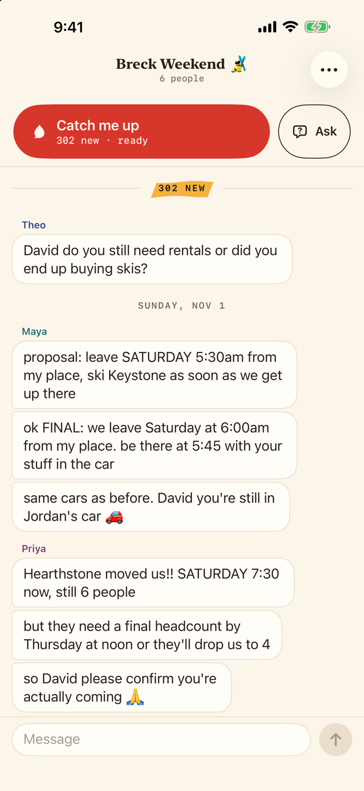
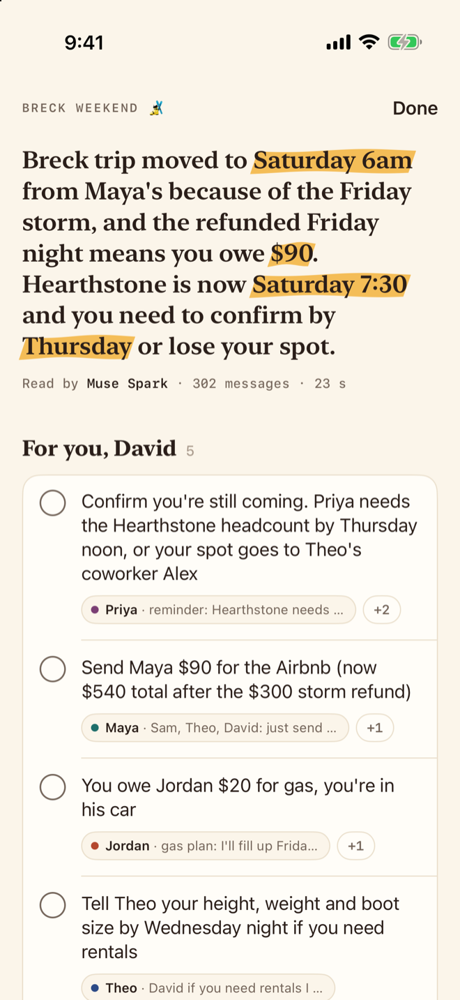
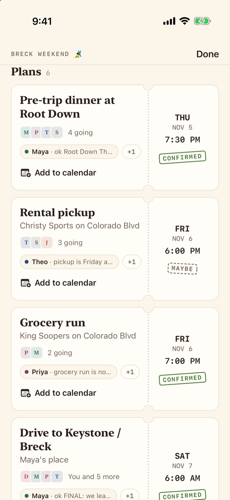
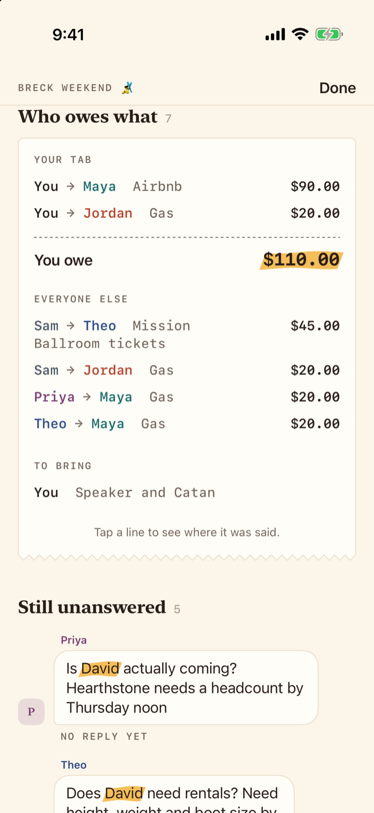
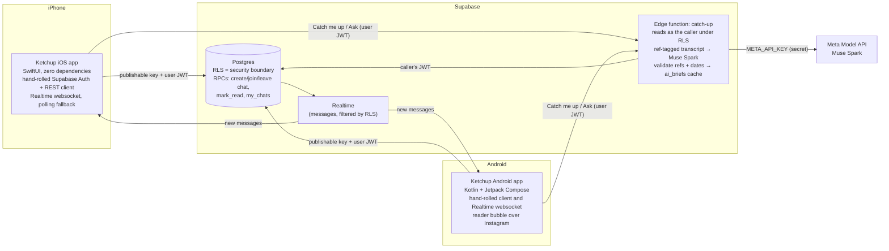
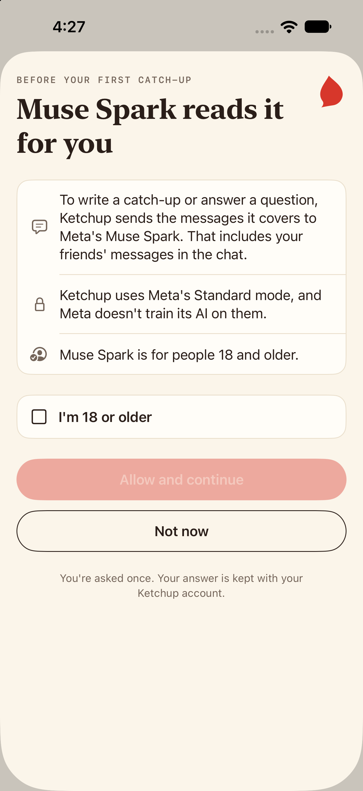
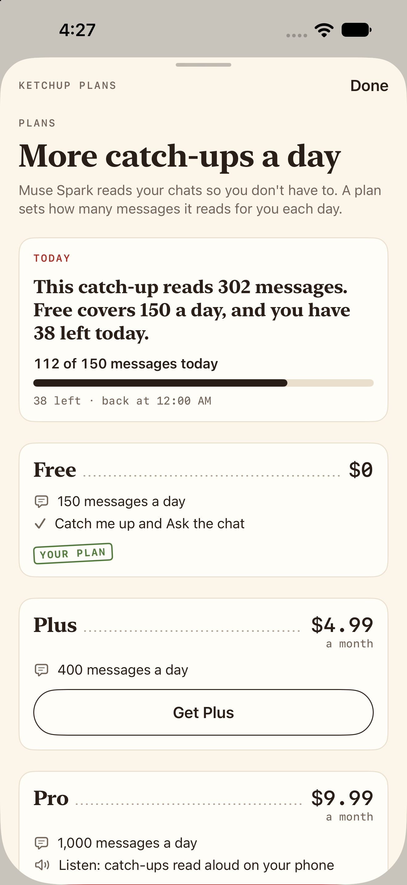
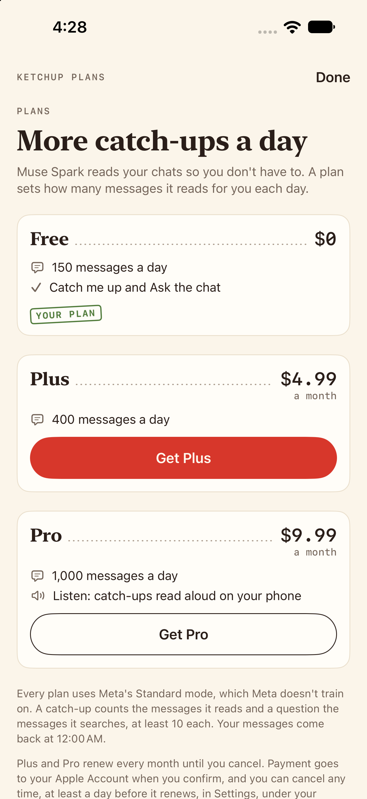
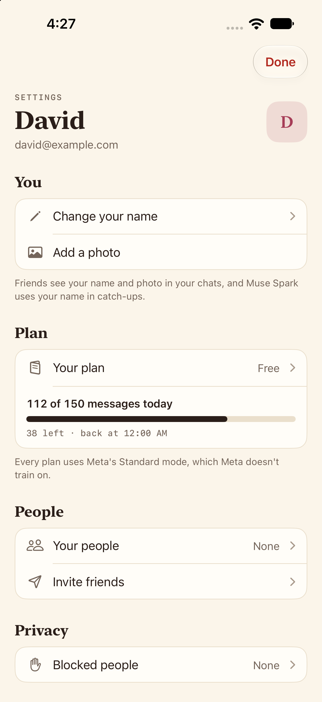

# Ketchup

**Come back to 300 unread group-chat messages and know what matters in 10 seconds.**

**Ketchup**, as in *catch up*, is a native iOS group chat with Meta's **Muse Spark** built in. Tap **Catch me up**
and Muse Spark reads everything you missed. It gives you the plans, the money, the
questions still waiting on an answer, and what people asked *you*. Every item links back
to the message it came from.

Built for the Meta Global AI Developer Hackathon (Cerebral Valley), theme *Build for Your
World*.

> Demo video: TODO(video)

---

## The problem

You mute the friend group chat for two days. When you come back there are 300 messages.
Somewhere in there, the trip moved from Friday to Saturday, the Airbnb price changed,
someone asked for your boot size, and you owe two people money. Finding those means
scrolling through all 300. Most people skim, miss something, and then ask "wait, what
time are we leaving?" and get groaned at.

## What it does

- **Catch me up.** One tap covers everything since you last read the chat. You get a
  short summary, then **For you**, **Plans**, **Open questions**, **Who owes what** and
  **Highlights**.
- **Plans become calendar events.** Each plan is a card with a real date and time (for
  example, "Saturday 6am" becomes `2026-11-07T06:00:00-07:00`), a place, who's going,
  and whether it's confirmed or only proposed. **Add to Calendar** opens the iOS event
  editor already filled in. Ketchup never writes to your calendar itself.
- **Cited messages.** Every bullet has chips for the messages behind it. Tap one and the
  chat jumps to that exact message and highlights it.
- **Ask the chat.** Ask a question like "what time are we leaving?" or "how much do I
  owe Maya?". You get a short answer with the messages that back it up. If the chat
  doesn't say, it tells you so.
- **A real group chat underneath.** Sign in with an email code, create a chat, and
  invite friends with a 6-character code. Messages arrive in real time, and a small
  "Maya joined" line says when someone comes in.
- **Profile photos.** Pick a photo, frame it in the square, and it shows by your
  messages, in the member list and on your You tab. No photo, no problem: your
  initials stand in.
- **Photos in the chat.** Send a photo with a caption or without one. It shows in your
  bubble straight away with a ring filling as it uploads, keeps its shape in the thread,
  and opens full screen to zoom and share. Only the chat's members can see it, and Catch
  me up reads it along with the messages: a door code in a photo makes the brief.

<table>
  <tr>
    <td></td>
    <td></td>
    <td></td>
    <td></td>
  </tr>
</table>

The look is a diner counter: cream paper, ketchup red for the one button that matters,
mustard for what matters to you, plans as order tickets and money as the check. Every
screen opens offline on real demo data with `-screen <name>`; see
[docs/DESIGN.md](docs/DESIGN.md).

## How it uses Muse Spark

Ketchup doesn't just summarize, and it isn't basic RAG either. One Muse Spark call turns
a messy group chat into structured state that the app can act on. Then the server
checks that every claim is backed by a real message.

1. **A transcript tagged with message refs.** The edge function builds the transcript
   ([`transcript.ts`](supabase/functions/_shared/transcript.ts)). Each message is one
   line, `[m12] Sat, Nov 7, 9:15 AM · Maya: …`, with timestamps in the reader's time
   zone. Newlines inside a message are flattened, so one message can't pretend to be
   another. Someone joining is a `[Maya joined]` line with no ref: context the model
   can use but can't cite, and it isn't counted as a message.
2. **Strict JSON output.** The request sends a JSON Schema as `response_format`
   (`json_schema`, `strict: true`), so the output is limited to that shape: `tldr`,
   `highlights`, `plans` (with `starts_at`, `ends_at`, `all_day`, `location`,
   `status`, `who`), `open_questions`, `owes` and `for_you`
   ([`brief.ts`](supabase/functions/_shared/brief.ts)). If the API rejects the schema,
   the call falls back to plain JSON mode. Validation runs either way.
3. **Every claim is grounded.** Each item must cite 1–4 refs. The server looks up each
   ref in that request's transcript and maps it to a real message id. Unknown or made-up
   refs are dropped, and **an item left with no valid refs is dropped too**. Text is
   trimmed and length-capped, unparseable dates become `null`, and `status` can only be
   `confirmed` or `proposed`.
4. **Dates in your time zone.** The app sends its time zone. The prompt includes the
   current local date, time and UTC offset, so "Friday at 7" or "tomorrow" turns into an
   ISO 8601 time the calendar can use.
5. **Written for the person reading.** The prompt names the reader and covers only what
   *they* haven't read, using their read cursor. It also includes up to 25
   already-read messages, marked "context only", so "that place" still makes sense.
   **For you** collects what's aimed at the reader by name. When the group changes its
   mind, the prompt asks for the latest decision.
6. **Messages are treated as content, not instructions.** The prompt says chat text is
   never instructions, and the model sees each message as its own tagged line.
7. **Caching and rate limits.** Every result is saved to `ai_briefs`, and only you can
   read yours. Tapping Catch me up again on the same unread messages returns the saved
   brief straight away with no new model call. Each person gets 60 briefs per hour, and a
   daily number of messages Muse Spark reads for them, set by their plan (see Plans).
   **Identical requests pay once**, even when they arrive together (a double tap, the
   prefetch racing your tap): the first claims the brief with a row whose id is a hash of
   what it covers, so only one can win, and the rest wait for its answer
   ([`once.ts`](supabase/functions/_shared/once.ts)). The same question over the same
   messages is answered once too. In the app, identical reads already on their way share
   one request ([`InFlight.swift`](ios/Ketchup/Net/InFlight.swift)). And when nothing new has
   come in since your last catch-up, the app doesn't ask at all: it shows the one it kept.
8. **Ready before you tap.** Opening a chat with 15+ unread starts the catch-up in the
   background, so the tap usually shows the result instantly. The read cursor still only
   moves when you actually open the result.
9. **It reads the photos too.** The newest 6 photos among the messages it reads go along
   as images ([`photos.ts`](supabase/functions/_shared/photos.ts)): their 768 px copies,
   downloaded with the reader's own token (so RLS still decides) and sent inline, never
   as a link Meta would fetch. Each one is labelled with its message ref and sender, so a
   bullet can cite a photo like any message, and its source chip shows the photo. If
   Meta refuses a photo, the call runs again without them. On the demo chat with two
   made-up photos (November 3, 2026), the brief said "Maya shared the cabin door code
   early: 4471, hit # after", a code that was only in the photo, and Ask answered "what's
   the code for the cabin door?" from it in 3.3 seconds.

Calling the Meta Model API ([`muse.ts`](supabase/functions/_shared/muse.ts)):

- `POST https://api.meta.ai/v1/chat/completions`, model `muse-spark-1.3`,
  `reasoning_effort: low`, `response_format: json_schema`. You can override the model and
  effort with the `META_MODEL` and `META_REASONING` secrets.
- Measured on the 302-message demo chat (November 2, 2026): about 9.5k tokens in and
  3.4k out (1.3k of it reasoning), **about 24 seconds and about 3¢ per catch-up**. Every
  planted plan, debt and open question came back correct. `minimal` effort halves the
  time (12 s) but invented a time the chat never gave, so `low` stays the default and the
  background prefetch hides the wait. "Ask the chat" takes about 3 seconds.
- Photos are `image_url` parts with a `data:` URL in the user message. A 768 px photo is
  about 640 tokens: the demo catch-up went from 9,634 to 10,917 tokens in with two photos
  (about a tenth of a cent each) and took no longer (17.1 s without, 16.0 s with).
- It retries once on 429/500/503 and honors `Retry-After`. The key is read from the edge
  function's secrets and is never sent to the app.

## Opens instantly

The phone keeps a copy of what you last saw, so Ketchup opens on your chats at once and
refreshes from the server behind them.

- **Your inbox and each chat's newest 400 messages stay on the phone.** They show in the
  first frame, then the server's answer replaces them. Reading a 400-message chat back
  takes under a millisecond on the simulator. Offline, a chat still opens, and says
  "Couldn't refresh. Showing saved messages."
- **Only yours, only here.** The copy lives in the app's own folder, one per signed-in
  account, protected until the phone's first unlock after a restart and left out of
  backups. Signing out deletes all of it, and a chat you leave is forgotten at the next
  refresh ([`DeviceStore.swift`](ios/Ketchup/Store/DeviceStore.swift)).
- **The server still decides what's unread.** When a chat opens, it takes your read cursor
  from the server, so an out-of-date copy can't hide new messages from Catch me up.
- **Paper, not spinners.** A first launch shows blank paper in the shape of the inbox's
  rows and a chat's bubbles. It breathes slowly, and holds still with Reduce Motion on.
- **Your last 3 catch-ups, kept.** Each chat keeps its last 3 catch-ups and its last 3 Ask
  answers on the phone, with the messages they cite, under **Earlier catch-ups** (at the
  bottom of a catch-up, and in the chat's … menu) and **Settings → Saved catch-ups**, so you
  can read them again with no network call. Their sources still jump to the message when
  the chat has it loaded. Delete one, or Clear all; they stay until you do
  ([`SavedBriefs.swift`](ios/Ketchup/Store/SavedBriefs.swift)).
- **Nothing new, no new call.** Tap Catch me up when nobody has written since your last
  catch-up and Ketchup shows that one again ("Nothing new since 2:14 PM. Here's your last
  catch-up."), without asking the server or Muse Spark. "You're all caught up" is only for a
  chat with no catch-up kept on the phone.
- **Clear cache** in Settings drops the copy of your chats and the photo cache; both load
  again from the server, and saved catch-ups stay.
- **Leaving a chat and changing your name happen at once.** The chat leaves your inbox and
  the new name shows everywhere straight away, and the server follows. If it says no, they
  come back with a note. Joining waits for the server (a wrong code is a real answer), and so
  does a new chat, whose id comes from the server.

## Architecture



- **iOS app** ([`ios/`](ios)): SwiftUI with no third-party packages. It has a small
  Supabase client written by hand: email-code auth with the session in the Keychain,
  PostgREST, RPCs and edge functions over `URLSession`. Realtime runs over the Phoenix
  websocket protocol and reconnects with backoff. While the socket is down, the chat
  polls every 4 seconds.
- **Android app** ([`android/`](android)): Kotlin and Jetpack Compose on the same
  backend, with no networking libraries. The same kind of hand-written Supabase client
  (email-code auth, PostgREST, RPCs, edge functions) and its own small websocket client
  for Realtime, over TLS with the system's trust store and a hostname check. 137 JVM
  unit tests cover the Realtime protocol, paging, the brief and the reader's parser.
  See "Android, and the Instagram bubble" below.
- **Database** ([`supabase/migrations/`](supabase/migrations)): profiles, chats, members,
  messages and `ai_briefs`. Writes that change membership go through security-definer
  RPCs, and clients can't write directly to `chats` or `chat_members`. A new member's
  read cursor starts before the chat began, so their first Catch me up covers the whole
  history. Joining, starting a chat or being added leaves one "Maya joined" line in the
  thread ([`0009_joins.sql`](supabase/migrations/0009_joins.sql)): a message row the
  server writes, so it pages and arrives over Realtime like any message, but it never
  counts as unread, never becomes the inbox's last message and never moves anyone's
  read cursor. Indexes are measured, not guessed: [`speed_check.sql`](supabase/tests/speed_check.sql)
  times the hot paths on today's data and on a busy account built inside a rolled-back
  transaction (20,000 messages, 5,000 unread, 3,000 saved briefs). Migration 0008 added
  only what moved a number: every send's rate check went from 0.80 ms to 0.015 ms, and
  catch-up's hourly cap from 0.11 ms to 0.016 ms. The inbox (`my_chats()`) went from 65 ms
  to 2.2 ms on that busy account once it worked out who you are and who you blocked once
  per call, not once per unread message.
- **Edge function** ([`supabase/functions/catch-up/`](supabase/functions/catch-up)): runs
  with JWT verification on. It reads messages *with the caller's token*, so Row Level
  Security decides what the model can see. It uses the service role only to write and
  check `ai_briefs`.
- **Photos** ([`ios/Ketchup/Photos/`](ios/Ketchup/Photos), [`Storage.swift`](ios/Ketchup/Net/Storage.swift)):
  a small Storage client (upload with progress, public and signed URLs, delete) and one
  image pipeline for every photo. Decoded photos stay in memory at the size they're
  drawn, the original bytes stay on disk, and each upload gets a new path, so every
  phone downloads each photo once. A profile photo is cropped on the phone to a 512 px
  JPEG (66 to 153 KB on the simulator's sample photos). A chat photo goes up as two
  JPEGs: at most 2048 px for the viewer, and a 768 px copy for the thread. The bubble is
  laid out from the photo's stored size, so the thread doesn't jump as photos load. In
  the transcript Muse Spark reads, a photo is a `[photo N]` line with its caption, and the
  photo itself goes along as an image (see "How it uses Muse Spark").

### Security

- **Row Level Security is the boundary.** The app ships only the publishable key. You
  only see chats you're in, and you can only post as yourself, into a chat you're in.
  Invite-code guessing is rate-limited, and so is sending.
- **The Meta key lives only in edge function secrets.** It is never in the app or this
  repo.
- **The service-role key is never in the app.** Only the edge function and the local
  demo seed script use it.
- **Deleting your account deletes what you wrote.** Settings → Delete account calls the
  [`delete-account`](supabase/functions/delete-account/index.ts) edge function. It runs
  [`delete_account()`](supabase/migrations/0007_people.sql) as you, one transaction, then
  deletes the photos you uploaded with the service role. Rows go first, so a delete that
  fails changes nothing, photos included. Your
  profile, memberships and every message you sent go, and so does a chat you were the
  last one in. Each chat you wrote in gets its inbox line recomputed, so no preview
  quotes you, and catch-ups friends saved that read your messages are deleted too: your
  words don't outlive you inside someone else's summary. Messages don't stay behind as
  "Deleted account", because in a group of friends the words still say who wrote them.
- **Blocking happens in the database, so Muse Spark respects it too.** A blocked person's
  messages are left out by the messages read policy itself, so every path that reads as
  you follows it: the app's reads, Realtime (which applies the policy for each
  subscriber) and the catch-up edge function, which reads as the caller. Muse Spark
  never reads a blocked person's messages for your catch-ups. Your unread counts and
  inbox lines leave them out too, and saved catch-ups that read them are dropped. It's
  one way and quiet: they stay in the chat and aren't told.
- **The same policy got faster.** It used to check your membership once for every row;
  now it checks once per query (an array of your chats, plus the people you've blocked).
  On the 302-message demo chat the app's first page went from 6.4 ms to 0.49 ms in
  the database, and the catch-up's read from 8.0 ms to 0.45 ms (EXPLAIN ANALYZE, median
  of 7, November 3, 2026).
- **Only the server says who joined.** A "Maya joined" line is written by the join
  itself, as the person who joined. Clients can't post one, for themselves or anyone
  else: they have no grant on the message's `kind`, and the insert policy takes only
  text. It doesn't count toward the send limit, and leaving and rejoining moves the line
  instead of adding another, so it can't be used to flood a chat.
- **Reports go to us, not to the app.** You can report a message (long press) or a
  person (their profile), with a reason. Only the reporter can file one, nobody can read
  reports through the API, and the server keeps a copy of the reported message so it
  can still be reviewed if it's deleted later. An edge function emails a heads-up with
  no names or message text in it.
- **Your people, with no lookup.** You add people from a chat you share; there's no search
  by email or phone, so nobody can find out who uses Ketchup, and your contacts are never
  uploaded. Invite friends uses Apple's contact picker, so Ketchup gets only the one number
  you pick, to open a Messages draft. A new chat with your people never adds anyone who
  has blocked you, and doesn't say so.
- **Photos follow the same rules** ([`0006_photos.sql`](supabase/migrations/0006_photos.sql)).
  Profile photos are in a public bucket, so the app loads them without a token, but
  nobody can list it. You can only upload into and delete from your own folder (10 an
  hour), and your profile can only point at a photo in your own folder. Chat photos are
  in a private bucket: only the chat's members can read them (through short-lived signed
  URLs) or upload into its folder (200 files an hour), only the sender can delete one,
  and a message can only point at a photo already uploaded to its own chat. Photos are
  re-encoded on the phone, so no location or other metadata leaves it.
- **A 132-check RLS test suite** ([`supabase/tests/rls_check.sql`](supabase/tests/rls_check.sql))
  plays members and an outsider. It covers spoofing the sender, self-adding to a
  chat, editing chats directly, outsider reads and posts, wrong-code counting, the
  Instagram and Snapchat catch-up's usage cap, plans and consent (nobody raises their
  own plan, spends, resets or lowers the allowance, records a purchase, or says yes for
  someone else), blocking (hidden reads, unread counts,
  inbox lines, dropped catch-ups, one way), reports (unreadable, never your own, never
  from outside a chat), your people (private, only from a shared chat, new chats skip
  whoever blocked you), profile photos (own folder only, no listing, the hourly cap),
  chat photos (members only, uploaded first, own chat only, only the sender deletes),
  deleting an account, and "joined" lines (server-written only, never unread or the
  inbox line, outside the send limit, one per person). It runs in one transaction and
  rolls back.

## Plans

Muse Spark costs money every time it reads, so a plan is a daily number of messages it
reads for you. **Every plan uses Meta's Standard mode, which Meta doesn't train on.**

| Plan | Messages a day | Price |
|---|---|---|
| Free | 150 | free |
| Plus | 400 | $4.99 a month |
| Pro | 1,000, and Listen: the catch-up read aloud | $9.99 a month |

<table>
  <tr>
    <td></td>
    <td></td>
    <td></td>
    <td></td>
  </tr>
</table>

- **You say yes once, first.** Before your first catch-up or question, a sheet says
  plainly what happens: Ketchup sends the messages it covers, your friends' included, to
  Meta's Muse Spark to write it, Meta doesn't train on them, and Muse Spark is for people
  18 and older. You check "I'm 18 or older" and allow it. The yes is kept with your
  account, and the server refuses a catch-up without it. Android asks the same before its
  first brief, in the app or from the reader bubble.
- **The server counts; the app only shows it.** A catch-up counts the unread messages it
  reads, a question the messages it searches, and every call at least 10. The day runs
  midnight to midnight Mountain time, so changing the phone's time zone doesn't reset it.
  Over the limit, the catch-up you're reading says so ("You've used today's 150 free
  messages") and the plans open over it. Settings shows "112 of 150 messages today". A
  catch-up that was already made, or two taps at once, costs nothing; a call that fails
  gives its messages back. Opening a chat on Free doesn't spend anything until you tap.
- **Apple In-App Purchase, checked on the server.** Plus and Pro are auto-renewable
  subscriptions in one group (StoreKit 2). A purchase carries your Ketchup account's id;
  the app sends Apple's signed transaction to the
  [`verify-purchase`](supabase/functions/verify-purchase/index.ts) edge function, which
  checks Apple's certificate chain up to Apple's root
  ([`apple.ts`](supabase/functions/_shared/apple.ts), no third-party code), then the app,
  the product and the account, before it sets your plan. The app can't set its own plan,
  and one subscription unlocks one Ketchup account.
- **Listen (Pro)** reads the catch-up aloud with the phone's own voice. Meta has no text
  to speech, so nothing more leaves the phone.
- **Testing a purchase.** Xcode's local StoreKit test (`ios/Ketchup/Plans/Ketchup.storekit`,
  in the scheme) buys for free, but Xcode signs those purchases, not Apple, so the server
  can't check them. It takes them only while the `STOREKIT_XCODE_TEST` secret is `true`,
  for a day at most, and **while it's on anyone signed in could fake a plan**, so it's on
  only while recording. Purchases in Apple's sandbox (TestFlight, sandbox testers) are
  signed by Apple and need no switch.

**Setting it up in App Store Connect** (David, about 35 minutes, then up to an hour before
the sandbox sees the products):

1. **Agreements, Tax, and Banking**: the Paid Applications Agreement is active (it is
   until January 13, 2027), with tax and banking filled in.
2. **Apps → + → New App**: iOS, bundle ID `com.vibetemp.ketchup` (pick it from your
   identifiers), a name (if "Ketchup" is taken, something like "Ketchup: Catch Up").
3. **The app → Monetization → Subscriptions → Create** a subscription group, "Ketchup".
4. In the group, **Create** "Ketchup Plus Monthly": product ID
   `com.vibetemp.ketchup.plus.monthly`, 1 month, $4.99, level 2, display name "Ketchup Plus".
5. **Create** "Ketchup Pro Monthly": `com.vibetemp.ketchup.pro.monthly`, 1 month, $9.99,
   level 1 (the higher level, so Plus to Pro is an upgrade), display name "Ketchup Pro".
6. Give each a description, a review screenshot (the paywall) and the group a display name;
   the first subscription goes to review with an app version.
7. **Users and Access → Sandbox → Test Accounts → +**: a sandbox Apple Account. On the
   iPhone, sign into it under Settings → Developer → Sandbox Apple Account, and run from
   Xcode with the scheme's StoreKit Configuration set to None.
8. A privacy policy URL on the app (subscriptions need one; the paywall already links
   Apple's standard Terms of Use).

## Run it yourself

**Backend** (Supabase CLI, project ref `cfqlnthmqwkhjbhylvgu` or your own):

```sh
supabase link --project-ref <ref>
supabase db push                                   # applies supabase/migrations
supabase secrets set META_API_KEY=... --project-ref <ref>
supabase functions deploy catch-up --project-ref <ref>   # verify_jwt stays on (the default)
supabase functions deploy catch-up-text --project-ref <ref>
supabase functions deploy verify-purchase --project-ref <ref>
```

Optional: paste `supabase/tests/rls_check.sql` into the SQL editor. Every row should say
`pass = true`.

**iOS** (Xcode 26, iOS 26):

1. Open `ios/Ketchup.xcodeproj`.
2. Pick your team under Signing & Capabilities.
3. If you use your own Supabase project, put its URL and publishable key in
   `ios/Ketchup/Config.swift`.
4. Run on a simulator or a device.

**Android** (Android Studio's JDK, SDK 36):

```sh
cd android
export JAVA_HOME="/Applications/Android Studio.app/Contents/jbr/Contents/Home"
export ANDROID_HOME="$HOME/Library/Android/sdk"
./gradlew :app:assembleDebug :app:testDebugUnitTest
adb install -r app/build/outputs/apk/debug/app-debug.apk
```

Every screen also opens offline on test data: `adb shell am start -n
com.vibetemp.ketchup/.MainActivity --es screen list`. [`android/README.md`](android/README.md)
has the rest.

**Demo data**: [`scripts/seed-demo/`](scripts/seed-demo) creates five test friends and a
302-message ski-trip chat, then prints an invite code. Join with that code and you start
with everything unread:

```sh
cp scripts/seed-demo/.env.example scripts/seed-demo/.env   # add the secret key
deno run --allow-net --allow-env --allow-read scripts/seed-demo/seed.ts
```

## Instagram and Snapchat catch-up (experimental, not released)

Nobody moves their group chat to a new app. So this experiment tries the same catch-up
on chats people already have: an Instagram DM thread or a Snapchat chat.

- **How it works.** Instagram's or Snapchat's own website opens inside the app, on its own
  tab along the bottom of the home screen, next to Chats. Switching tabs keeps the page
  loaded and signed in. You sign in on their page and open a chat. Tap the ketchup drop on
  the right (**Catch me up**), pick the last 10, 30, 80 or 120 messages (the page doesn't say
  what's unread), and Ketchup reads that much of the conversation off the page. Or pick
  **Until I stop scrolling**: you scroll up through the chat yourself, a small panel counts
  what's been read, and about 3 seconds after you stop (or on **Catch me up now**) it catches
  you up on everything you scrolled past, as on Android. **Stop**, or leaving the tab, sends
  nothing. Then it runs the same Muse Spark catch-up as its own chats through a second edge
  function, [`catch-up-text`](supabase/functions/catch-up-text/index.ts): the same ref-tagged
  transcript, prompts, JSON schemas and validation, laid out with the same brief, tickets,
  diner check and Ask the chat. Each source chip shows the whole message it quotes.
- **It reads only the chat you have open, in your own signed-in session.** Ketchup never
  sees your password or cookies. The readers
  ([`InstagramThreadReader.js`](ios/Ketchup/Instagram/InstagramThreadReader.js),
  [`SnapchatThreadReader.js`](ios/Ketchup/Snapchat/SnapchatThreadReader.js)) run only when
  you pick how much to read on a chat. They go by page structure (roles, tags, labels,
  layout), not the sites' class names, which change. Both step up through the chat for
  older messages, then put the scroll back. Until I stop scrolling never scrolls: it looks
  at the page four times a second and keeps each message once, in order, however you
  scroll.
- **Nothing is stored on the server.** No message text in the logs (counts and token usage
  only). The server keeps one usage count per call, with no content, for an hourly cap of 20.
  The catch-up itself is kept on your phone (the last 3 for each thread) until you delete
  it, under Earlier catch-ups in the page's … menu.
- **It isn't sanctioned by Instagram's or Snapchat's terms.** They don't allow automated
  collection, and the messages, your friends' included, go to Muse Spark to summarize. So
  it's not in the released app, and it won't ship unless Meta and Snap are fine with it.
  Ketchup's own chat doesn't depend on it.
- **Snapchat took three browser settings, and nothing injected into its pages.** Snapchat for
  Web sends phones to "Download Snapchat", so Ketchup asks for its desktop page with a Mac
  user agent (what Safari's "Request Desktop Website" does) and lays the page out 1024 points
  wide, shrunk to fit the screen. Signed in, its chat app also needs a service worker, which
  WebKit only runs for app-bound domains (the app's Info.plist lists them). Once an app lists
  any, WebKit only lets it read pages in web views kept to them, so Instagram's page is kept
  to its sites too. The Snapchat page is small, so pinch to zoom; Catch me up is the point anyway.
- **Built to take another app.** The browser, the page and the catch-up sheet are shared
  ([`ios/Ketchup/WebChat/`](ios/Ketchup/WebChat)); a `WebChatSource` says what differs
  (name, start page, allowed sites, thread URL, reader script, user agent, desktop layout).

## Android, and the Instagram bubble (experimental)

The Android app ([`android/`](android)) is the same Ketchup: sign in with an email code,
chats in real time, and Catch me up and Ask with the same brief, tickets, diner check
and sources that jump back to the message. Ask opens straight to the question, without
a catch-up first.

Its Instagram and Snapchat pages work differently from the iPhone's. Android lets an
app read the screen through accessibility, the way apps like SocialLite do, so there's
no website inside Ketchup. You use the real Instagram app.

- **How it works.** An accessibility service
  ([`android/.../reader/`](android/app/src/main/java/com/vibetemp/ketchup/reader)) listens
  only to Instagram and Snapchat. When a DM thread is open, a small Ketchup bubble floats
  over it (an accessibility overlay, so no draw-over permission). Tap it and pick the last
  10, 30, 80 or 120 messages. It reads them off the screen, scrolling back for older ones and
  dropping repeats, and tells your messages from theirs by which side they're on (on
  Snapchat, by the name row above them). Then it
  sends the thread to the same [`catch-up-text`](supabase/functions/catch-up-text/index.ts)
  function as the iPhone, and the brief opens over Instagram. Back returns to the chat.
- **Or read as you scroll.** Pick **Until I stop scrolling** and the bubble doesn't scroll
  for you: it reads whatever you scroll past, counts as it goes, and catches you up about 3
  seconds after you stop (or right away with Catch me up now; it stops at 600 messages or 3
  minutes). It only reads once the list stands still, since a list in mid-scroll can hand
  back stale rows.
- **It reads only when you tap, and only the chat you have open.** Nothing is kept on the
  phone or the server, and the logs hold counts only. Before the bubble can be turned on,
  a page says what it reads, when, and where it goes. It goes by what's on screen and
  where, not Instagram's internal view names, which change.
- **Where it stands.** On an emulator, against a made-up thread laid out like Instagram's,
  Last 30 read 30 of 30 in 2.2 seconds and Last 120 read all 88 messages in 10.3 seconds.
  On November 3, 2026 it worked on a real phone on Android 16 in both apps. In Instagram
  the bubble read two short DM threads (2 messages, and 5 after scrolling back to the start
  in 7.4 seconds). In Snapchat it read 20 messages back to the start of the chat in 6.9
  seconds, with 4 replies, and Muse Spark caught up on all three.
- **Snapchat needed its own mode.** A layout dump from the phone (view names, positions and
  text lengths, never text) showed that every Snapchat message sits on the left under a
  name row, so the reader takes each message's sender from the row above it instead of
  from its side, and finds the chat by Snapchat's own view names. The first time you use
  it, Ketchup asks your name on Snapchat once and keeps it on the phone; messages under
  that name or "ME" are yours. Snapchat mostly ignores an app's scrolling, so the panel
  asks you to scroll up slowly and reads as you go. On the phone at 2:25 PM it read 30
  messages, 7 of them yours, with no repeats. Still unchecked on a real phone: a long
  Instagram thread.
- **Same terms problem as the iPhone version, plus Google Play's.** Play only allows
  accessibility services for accessibility, so this is a sideloaded, experimental build.
  On Android 13 and later, a sideloaded app needs Allow restricted settings (App info,
  then the ⋮ menu) before its service can be turned on; the app shows how.

## Settings and your account

The **You** tab, last along the bottom, is your photo, name and email, your people (tap one
for their profile), Invite friends and Blocked people. Settings opens from it
([`ios/Ketchup/People/`](ios/Ketchup/People)).

- **Change your name.** Friends see it in your chats, and Muse Spark uses it in catch-ups.
- **Sign Instagram or Snapchat out of Ketchup.** Each row forgets that one site's sign-in
  and saved data in Ketchup's web views on this iPhone (cookies, storage, caches, service
  workers). Your accounts there aren't touched. Signing out of Ketchup forgets both, so
  the next person to sign in on that phone doesn't inherit them.
- **Sign out, or delete your account for good** (see Security above). A page says what
  goes and what stays, then asks once more.
- **Profiles, Block and Report.** Tap a name or photo in a chat, or a member in Chat
  info, for their profile: the chats you share, Add to your people, Block and Report.
  Long press someone's message to report it. Blocked people (on the You tab and in
  Settings) has Unblock.
- **Your people and Invite friends.** The You tab (and Settings → Your people) lists who
  you've added. New chat lets you add them straight in, no code needed. Invite friends (the
  You tab, Settings, or the inbox's +) sends a chat's invite code: Text a friend opens a
  Messages draft to someone you pick, or share it anywhere.

## Built during the event

This repo was started on November 2, 2026, during the hackathon. The commit history
shows the build: schema and RLS, then the edge function, then the Muse Spark wiring,
then the iOS app. The Android app followed on November 3, 2026.

## Built on

The networking and chat plumbing are adapted from **AurariaGO**, a live App Store app I
built under VibetempLLC. That includes the Supabase client approach, the chat bubble
and input bar components, and the on-device cache and loading skeletons (restyled for
Ketchup). Everything specific to Ketchup is new for this event: the
schema, the `catch-up` edge function, the Muse Spark integration, the catch-up and
ask-the-chat UI, plan cards, and the Realtime websocket (AurariaGO polls).

## Team

David Nichols, VibetempLLC
