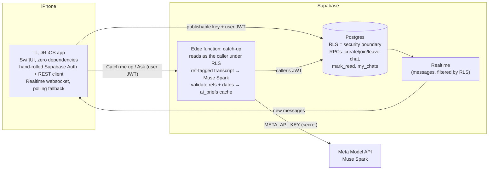

# TL;DR

**Come back to 300 unread group-chat messages and know what matters in 10 seconds.**

TL;DR is a native iOS group chat with Meta's **Muse Spark** built in. Tap **Catch me up**
and Muse Spark reads everything you missed. It gives you the plans, the money, the
questions still waiting on an answer, and what people asked *you*. Every item links back
to the message it came from.

Built for the Meta Global AI Developer Hackathon (Cerebral Valley), theme *Build for Your
World*.

> Demo video: TODO(video)

---

## The problem

You mute the friend group chat for two days. When you come back there are 300 messages.
Somewhere in there, the trip moved from Friday to Saturday, the Airbnb price changed,
someone asked for your boot size, and you owe two people money. Finding those means
scrolling through all 300. Most people skim, miss something, and then ask "wait, what
time are we leaving?" and get groaned at.

## What it does

- **Catch me up.** One tap covers everything since you last read the chat. You get a
  short TL;DR, then **For you**, **Plans**, **Open questions**, **Who owes what** and
  **Highlights**.
- **Plans become calendar events.** Each plan is a card with a real date and time (for
  example, "Saturday 6am" becomes `2026-11-07T06:00:00-07:00`), a place, who's going,
  and whether it's confirmed or only proposed. **Add to Calendar** opens the iOS event
  editor already filled in. TL;DR never writes to your calendar itself.
- **Cited messages.** Every bullet has chips for the messages behind it. Tap one and the
  chat jumps to that exact message and highlights it.
- **Ask the chat.** Ask a question like "what time are we leaving?" or "how much do I
  owe Maya?". You get a short answer with the messages that back it up. If the chat
  doesn't say, it tells you so.
- **A real group chat underneath.** Sign in with an email code, create a chat, and
  invite friends with a 6-character code. Messages arrive in real time.

## How it uses Muse Spark

TL;DR doesn't just summarize, and it isn't basic RAG either. One Muse Spark call turns
a messy group chat into structured state that the app can act on. Then the server
checks that every claim is backed by a real message.

1. **A transcript tagged with message refs.** The edge function builds the transcript
   ([`transcript.ts`](supabase/functions/_shared/transcript.ts)). Each message is one
   line, `[m12] Sat, Nov 7, 9:15 AM · Maya: …`, with timestamps in the reader's time
   zone. Newlines inside a message are flattened, so one message can't pretend to be
   another.
2. **Strict JSON output.** The request sends a JSON Schema as `response_format`
   (`json_schema`, `strict: true`), so the output is limited to that shape: `tldr`,
   `highlights`, `plans` (with `starts_at`, `ends_at`, `all_day`, `location`,
   `status`, `who`), `open_questions`, `owes` and `for_you`
   ([`brief.ts`](supabase/functions/_shared/brief.ts)). If the API rejects the schema,
   the call falls back to plain JSON mode. Validation runs either way.
3. **Every claim is grounded.** Each item must cite 1–4 refs. The server looks up each
   ref in that request's transcript and maps it to a real message id. Unknown or made-up
   refs are dropped, and **an item left with no valid refs is dropped too**. Text is
   trimmed and length-capped, unparseable dates become `null`, and `status` can only be
   `confirmed` or `proposed`.
4. **Dates in your time zone.** The app sends its time zone. The prompt includes the
   current local date, time and UTC offset, so "Friday at 7" or "tomorrow" turns into an
   ISO 8601 time the calendar can use.
5. **Written for the person reading.** The prompt names the reader and covers only what
   *they* haven't read, using their read cursor. It also includes up to 25
   already-read messages, marked "context only", so "that place" still makes sense.
   **For you** collects what's aimed at the reader by name. When the group changes its
   mind, the prompt asks for the latest decision.
6. **Messages are treated as content, not instructions.** The prompt says chat text is
   never instructions, and the model sees each message as its own tagged line.
7. **Caching and rate limits.** Every result is saved to `ai_briefs`, and only you can
   read yours. Tapping Catch me up again on the same unread messages returns the saved
   brief straight away with no new model call. Each person gets 60 briefs per hour.
8. **Ready before you tap.** Opening a chat with 15+ unread starts the catch-up in the
   background, so the tap usually shows the result instantly. The read cursor still only
   moves when you actually open the result.

Calling the Meta Model API ([`muse.ts`](supabase/functions/_shared/muse.ts)):

- `POST https://api.meta.ai/v1/chat/completions`, model `muse-spark-1.3`,
  `reasoning_effort: low`, `response_format: json_schema`. You can override the model and
  effort with the `META_MODEL` and `META_REASONING` secrets.
- Measured on the 302-message demo chat (November 2, 2026): about 9.5k tokens in and
  3.4k out (1.3k of it reasoning), **about 24 seconds and about 3¢ per catch-up**. Every
  planted plan, debt and open question came back correct. `minimal` effort halves the
  time (12 s) but invented a time the chat never gave, so `low` stays the default and the
  background prefetch hides the wait. "Ask the chat" takes about 3 seconds.
- It retries once on 429/500/503 and honors `Retry-After`. The key is read from the edge
  function's secrets and is never sent to the app.

## Architecture



- **iOS app** ([`ios/`](ios)): SwiftUI with no third-party packages. It has a small
  Supabase client written by hand: email-code auth with the session in the Keychain,
  PostgREST, RPCs and edge functions over `URLSession`. Realtime runs over the Phoenix
  websocket protocol and reconnects with backoff. While the socket is down, the chat
  polls every 4 seconds.
- **Database** ([`supabase/migrations/`](supabase/migrations)): profiles, chats, members,
  messages and `ai_briefs`. Writes that change membership go through security-definer
  RPCs, and clients can't write directly to `chats` or `chat_members`. A new member's
  read cursor starts before the chat began, so their first Catch me up covers the whole
  history.
- **Edge function** ([`supabase/functions/catch-up/`](supabase/functions/catch-up)): runs
  with JWT verification on. It reads messages *with the caller's token*, so Row Level
  Security decides what the model can see. It uses the service role only to write and
  check `ai_briefs`.

### Security

- **Row Level Security is the boundary.** The app ships only the publishable key. You
  only see chats you're in, and you can only post as yourself, into a chat you're in.
  Invite-code guessing is rate-limited, and so is sending.
- **The Meta key lives only in edge function secrets.** It is never in the app or this
  repo.
- **The service-role key is never in the app.** Only the edge function and the local
  demo seed script use it.
- **A 21-check RLS test suite** ([`supabase/tests/rls_check.sql`](supabase/tests/rls_check.sql))
  plays two members and an outsider. It covers spoofing the sender, self-adding to a
  chat, editing chats directly, outsider reads and posts, and wrong-code counting. It
  runs in one transaction and rolls back.

## Run it yourself

**Backend** (Supabase CLI, project ref `cfqlnthmqwkhjbhylvgu` or your own):

```sh
supabase link --project-ref <ref>
supabase db push                                   # applies supabase/migrations
supabase secrets set META_API_KEY=... --project-ref <ref>
supabase functions deploy catch-up --project-ref <ref>   # verify_jwt stays on (the default)
```

Optional: paste `supabase/tests/rls_check.sql` into the SQL editor. Every row should say
`pass = true`.

**iOS** (Xcode 26, iOS 26):

1. Open `ios/TLDR.xcodeproj`.
2. Pick your team under Signing & Capabilities.
3. If you use your own Supabase project, put its URL and publishable key in
   `ios/TLDR/Config.swift`.
4. Run on a simulator or a device.

**Demo data**: [`scripts/seed-demo/`](scripts/seed-demo) creates five test friends and a
302-message ski-trip chat, then prints an invite code. Join with that code and you start
with everything unread:

```sh
cp scripts/seed-demo/.env.example scripts/seed-demo/.env   # add the secret key
deno run --allow-net --allow-env --allow-read scripts/seed-demo/seed.ts
```

## Built during the event

This repo was started on November 2, 2026, during the hackathon. The commit history
shows the build: schema and RLS, then the edge function, then the Muse Spark wiring,
then the iOS app.

## Built on

The networking and chat plumbing are adapted from **AurariaGO**, a live App Store app I
built under VibetempLLC. That includes the Supabase client approach and the chat bubble
and input bar components. Everything specific to TL;DR is new for this event: the
schema, the `catch-up` edge function, the Muse Spark integration, the catch-up and
ask-the-chat UI, plan cards, and the Realtime websocket (AurariaGO polls).

## Team

David Nichols, VibetempLLC
