# Cetchup design

Cetchup looks like a diner counter: cream paper, warm ink, and one squeeze of ketchup red for the thing to press. Mustard marks what matters to you (a time, an amount, your name), pickle green stamps what's confirmed, plans arrive as order tickets and money as a diner check.

<p>


</p>

Code: `ios/Ketchup/Theme.swift` holds colors, type and motion; `ios/Ketchup/Design/` holds the shapes, buttons and labels. Launch a DEBUG build with `-screen design` to see every piece live (recipe at the bottom).

## House rules

- **One ketchup thing per screen.** Everything else is ink, outline or plain text.
- **Mustard means "this matters to you."** Never decoration.
- **No gradients, sparkles, glass, purple or drop shadows.** Paper sits on paper with a 1 pt hairline. One deliberate exception: the top-bar buttons keep iOS's system glass, so they behave like every other iPhone app (David's call, Nov 3, 2026). The rule is about cards, bubbles and bars we draw.
- **Muse Spark gets a byline** ("Read by Muse Spark"), not a sparkle.

## Color

Every token is a light/dark pair made with `Color(light:dark:)` (hex `0xRRGGBB`).

| Token | Light | Dark | Use |
|---|---|---|---|
| `cream` | FBF5EA | 17120F | App background |
| `card` | FFFDF8 | 231C17 | Raised paper: cards, other people's bubbles |
| `rule` | EADFCC | 3A302A | Hairlines, card borders |
| `ink` | 2A1E19 | F6EEE2 | Primary text, my bubbles |
| `inkSoft` | 74655A | B3A595 | Secondary text |
| `inkFaint` | A99A8C | 7A6C60 | Placeholders and decoration only, never text someone must read |
| `onInk` | FFF8EE | 17120F | Text on ink |
| `ketchup` | D7372B | E8473A | Brand red: the logo, the one button |
| `ketchupText` | B22A20 | FF7B6B | Small red text on cream (plain ketchup is too light); the app tint |
| `onKetchup` | FFF8EE | FFF8EE | Text on ketchup |
| `mustard` | F3B33D | E9A92F | Marker, unread badges, jump-to-message highlight |
| `onMustard` | 2A1E19 | 17120F | Text on mustard, both modes |
| `pickle` | 4F7A3A | 8CC07A | Confirmed stamps |

**People:** `Theme.people` has 8 name colors (brick, teal, plum, ochre, forest, navy, rose, slate). `personColor(name:)` gives the demo chat's six people six different colors; prefer it over `personColor(_ id:)` wherever a name shows, so Maya is the same teal in the chat and in Muse Spark's results.

## Type

| Role | Call | Use |
|---|---|---|
| New York | `.font(.serif(.title3))` (bold unless you pass `weight:`) | Headlines, section titles, the wordmark |
| SF Mono | `.font(.mono(.caption2))` (medium) | Times, amounts, codes, counts, kickers |
| SF Pro | `.font(.body)` and friends | Everything else |

Always use text styles so Dynamic Type works. The wordmark is the only fixed size.

## Motion

| Token | Value | Use |
|---|---|---|
| `Motion.snappy` | spring 0.3 s, no bounce | The default |
| `Motion.settle` | spring 0.45 s, no bounce | Bigger moves, content arriving |
| `Motion.lively` | spring 0.4 s, bounce 0.2 | Only something the user flicked or checked |
| `Motion.press` | spring 0.16 s, no bounce | Buttons going down and up |
| `Motion.sweep` | curve (0.23, 1, 0.32, 1), 0.5 s | The marker pass |
| `Motion.squirt` | same curve, 0.9 s | The wordmark's squiggle drawing in |
| `Motion.stagger` | 0.04 s | Gap between items arriving in a list (`Motion.staggered(_:index:)`) |
| `Motion.fade` | ease out 0.2 s | What Reduce Motion gets instead |

**Reduce Motion:** every animated piece checks `accessibilityReduceMotion`. In screens, use `.motion(_:value:)` instead of `.animation(_:value:)` and `.transition(.rise(reduceMotion:))` for things arriving; both turn into a plain fade.

## Components

| Piece | When to use it |
|---|---|
| `KetchupDrop()` | The logo: a ketchup drop with a chat-bubble tail. Fill with `ketchup`; reads from 16 pt up. |
| `DropShine()` | Highlight stacked on a big drop (icon, hero). Skip under about 40 pt. |
| `Wordmark(size:drawIn:)` | "Cetchup" in New York black italic with the mustard squiggle; `drawIn` draws it once. |
| `Squiggle()` | The squirt under the wordmark, or a quiet divider. Works with `.trim`. |
| `.buttonStyle(.ketchup)` | The one thing to press. Full-width red capsule, light haptic on press down. |
| `.buttonStyle(.ink)` / `.outline` | A strong second choice / a quiet one. |
| `.ketchup(.compact)`, `.ink(.compact)`, `.outline(.compact)` | Buttons inside cards ("Add to calendar", "Try again"). |
| `.buttonStyle(.pressable)` | Tappable cards and rows: scale only. |
| `Kicker("For you")` | Small mono caps over a headline or card. |
| `SectionTitle("Plans", count: 6)` | Section heading, a VoiceOver header. |
| `Monogram(name:color:size:)` | Initials on a soft tile of the person's color. Decorative. |
| `Avatar(name:path:size:)` | A person's photo in the monogram's rounded square with a hairline, or their `Monogram` while it loads or when there's none. Use it wherever a person shows. Decorative. |
| `Stamp("Confirmed")` | Rubber stamp on a plan; pickle by default, `inkSoft` and `dashed: true` for "Maybe". |
| `.marked(_:color:sweep:delay:)` | Marker behind a short phrase on one line. |
| `Text("…\(Text("$90").markedRun())…").markRuns(sweep:)` | Marker inside a sentence; follows the words as they wrap. |
| `.paperCard(padding:radius:)` | The default container: card paper, hairline, no shadow. |
| `Ticket { plan } stub: { stamp }` | A plan as an order ticket, parts placed either side of the tear line. Built on `TicketShape`, `PerforationLine` and `.ticketCard()`. |
| `.receiptCard()` | Money, as a diner check with a torn zigzag edge (`ReceiptShape`). |
| `Skeleton("Loading your chats") { … }` | A first load's blank paper: breathes (an opacity pulse), holds still with Reduce Motion, one "Loading" for VoiceOver. |
| `Bone(width:share:height:line:)` | One blank line of type in hairline paper, sitting in a real line height. |
| `InboxSkeleton()`, `ThreadSkeleton()`, `SkimSkeletonRows` | The inbox's rows, a thread's bubbles, the skim window's lines, before the first answer. |
| `JoinedLine(name:color:)` | Someone joined: "Maya joined", small and centered between bubbles like a day line, the name semibold in their `personColor` ("You joined" in ink), the rest `inkSoft`. It ends a run, so the next bubble shows its sender's name again. A new chat with only "You joined" in it still gets the empty note. |

The old purple names (`Theme.accent`, `aiGradient`, `aiDiagonal`, `aiWash`, `indigo`, `violet`, `pink`, `aiSymbol`, `aiName`) still compile but are deprecated and mapped flat onto this palette. Each warning is a spot still to restyle.

## Tabs

After sign-in, the home is four tabs along the bottom: **Chats** (the inbox, first), **Instagram**, **Snapchat** and **You** (`ios/Ketchup/Views/HomeTabs.swift`). The app comes back to the tab you were on last (`@AppStorage("home.page")`).

<p>


</p>

- **The bar is paper, not glass.** Cream under a 1 pt hairline. The tab you're on is ink, with a filled icon and a mustard `MarkerStroke` under its name that slides over as you switch (a fade with Reduce Motion); the others are inkSoft and outlined. No ketchup: that's for the page's one button.
- **The icons:** two bubbles for Chats, a camera for Instagram, a ghost drawn in the app for Snapchat (SF Symbols has none), and your own photo for You (your initials until there is one, and an ink ring when it's the tab you're on). Chats carries the inbox's unread count in a mustard badge.
- **Like a system bar** it stops growing at Extra Extra Large text, and a long press shows a tab big at accessibility sizes (Large Content Viewer). VoiceOver reads it as a tab bar, with the unread count on Chats.
- **Every tab keeps its place.** A tab is built the first time you open it, then kept: a web page loads once, stays signed in and doesn't reload as you switch back and forth.
- **In a chat the bar steps aside** (`Motion.fade`), so the chat's input bar has the bottom of the screen, and comes back with the inbox. The Chats tab says so through `HomeTabsState.locked`.
- **The keyboard covers the bar.** Over a site, the page keeps its size and the site moves its own message box, as in Safari.
- **`HomeTab.all`** lists the tabs, left to right: another chat app is one more `.web(…)` in the list.

### The You tab

Your profile, built from Settings' and People's pieces (`ios/Ketchup/People/YouView.swift`): how many chats you're in as a kicker over your name in New York, your email and your photo (`AccountHeader`, also Settings' header); **Your people**, each with their photo and a chevron to their profile (`PeopleList`, as on Your people); an outline **Invite friends**; **Privacy** with Blocked people; and **Account** with a Settings row that opens Settings as a sheet. Like Settings, it has no ketchup button.

## Photos

A profile photo is a print pinned to the paper: the same rounded square as a monogram, edged with a hairline. A photo in a chat is a bubble of its own shape. Screenshots: `screens/photos/` (made-up photos, no real people).

<p>


</p>

| Piece | What it does |
|---|---|
| `AvatarCropper` | "Frame it": the picked photo under paper with a rounded-square window cut out; drag and pinch, the photo always covers the window. "Use photo" is the one ketchup button and says "Saving" until the upload is done. VoiceOver can zoom with swipe up and down. |
| In a chat | Other people's photos sit by the last bubble of each run, bottom-aligned, 28 pt. Mine get none. |
| You tab | My photo is the You tab's icon (an ink ring around it when it's the tab you're on), and sits big in the You tab's header and in Settings'. |
| `PhotoBubble` | A chat photo in the thread: its own shape (between 1:2 and 2.2:1), at most 240 pt wide, laid out from its stored size before it loads. The caption sits under it in the same bubble, on card paper (theirs) or ink (mine), with a text bubble's run corners. Tap to open. |
| Upload ring | While my photo uploads: an ink ring filling a hairline track on a cream disc over the photo. "Not sent. Tap to retry" if it fails, like text. |
| Composer | A photo button before the field (`ChatInputBar(onPhoto:)`). The picked photo waits above the field with an ink x to take it off; the field says "Add a caption", and the ketchup send works with or without words. |
| `PhotoViewer` | Full screen on dark paper (17120F in both modes): pinch or double-tap to zoom, Share (and Save Image) in the top bar's glass buttons, who sent it and when in cream type under it. |

<p>
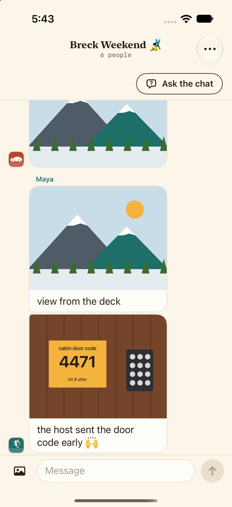
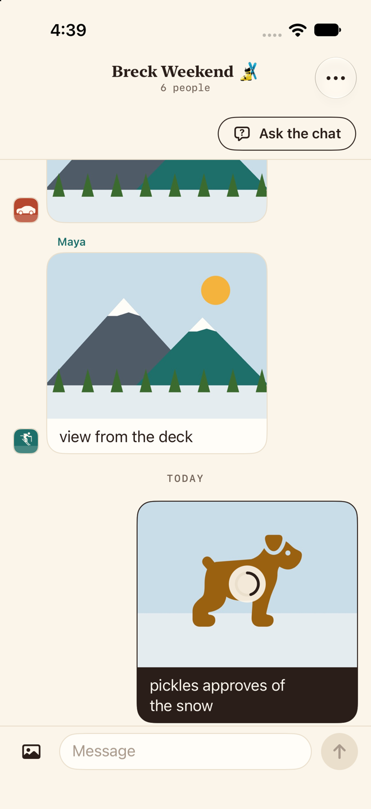
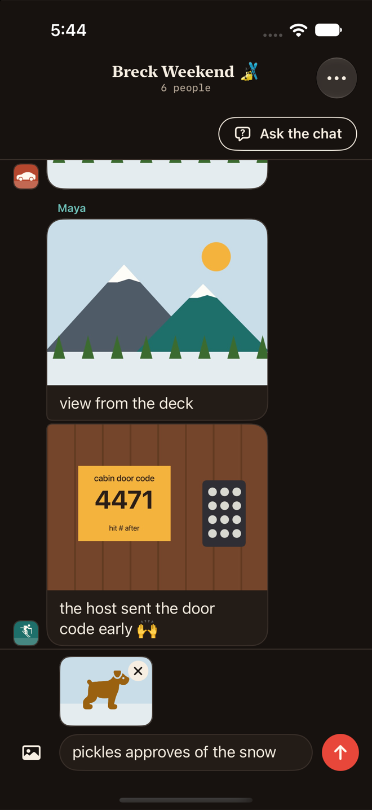
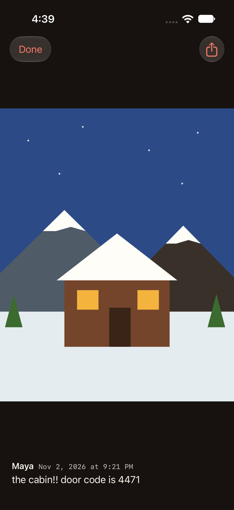
</p>

## Muse Spark screens

Catch me up and Ask the chat (`ios/Ketchup/AI/`) lay Muse Spark's JSON out on the counter. Screenshots: `screens/redesign/ai-*`.

<p>


</p>

| Piece | What it does |
|---|---|
| `SheetBar` | The pinned top of both sheets: the chat's name as a running head, and Done. |
| `BriefMarks` | Marks money and times in Muse Spark's sentences ("$90", "Saturday 6am", "by Thursday"; not an old "from $140"), or the reader's name in a question. Show with `.markRuns()`. |
| `MuseByline` | "Read by Muse Spark · 302 messages · 23 s", or "Saved" for a cached brief. |
| `RefChips` | Sources: a dot in the sender's chat color and how the message starts; a photo shows itself, small, where the dot goes. One chip and a "+2" to a line; a tap jumps to the message. |
| `SkimmingView` | The wait: the real unread messages pass a window while the marker reads each line, an honest clock, "Usually about 20 seconds". A still list with Reduce Motion. |
| `ForYouList` | The reader's to-dos. The circle checks one off with `.struck()`, a pen stroke through the words. |
| `PlanCard` | A `Ticket`: what, where, who, sources and Add to calendar; the stub has day, date, time and the stamp. Soonest first. |
| `OwesCheck` | A `receiptCard()`: your tab first with the total marked as it scrolls in, everyone else, then To bring. |
| `QuestionBubble` | An open question as the asker's message, "No reply yet" under it. |
| `AIErrorCard`, `CaughtUpCard` | A failed call with Try again; nothing new and no catch-up kept, with the drop. |
| `NothingNewNote` | Nothing new since the last catch-up kept on the phone: a paper note with a small drop, "Nothing new since 2:14 PM. Here's your last catch-up.", over that catch-up as it was. If people wrote after it and you've read them, "Nothing unread." |

- **Everything traces back.** A chip, a line on the check, a bubble or a to-do's words closes the sheet onto that message.
- **The reader is "You"**, in ink; everyone else is in `personColor(name:)`, as in the chat.
- **Mustard only on what's the reader's**: the times and money in the gist and in answers, their name in questions, their total.

## First loads

Cetchup opens on the copy it kept on the phone (`Store/DeviceStore.swift`), so a first load only shows on a first launch or a chat's first open. It's blank paper in the shape of what's coming, never a spinner. Screenshots: `screens/speed/`.

<p>
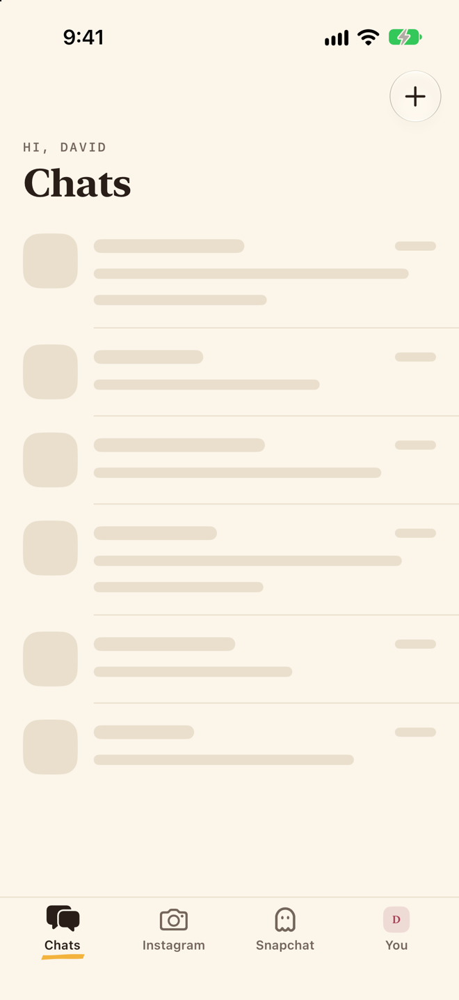
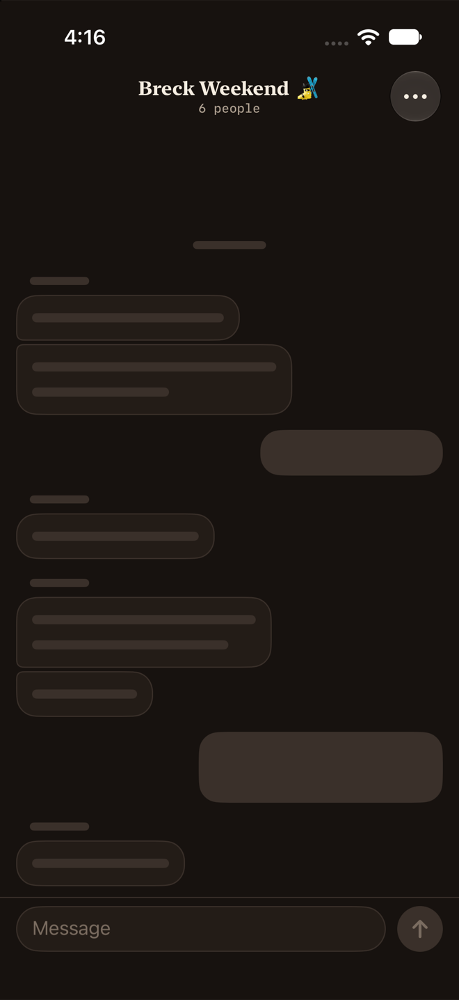
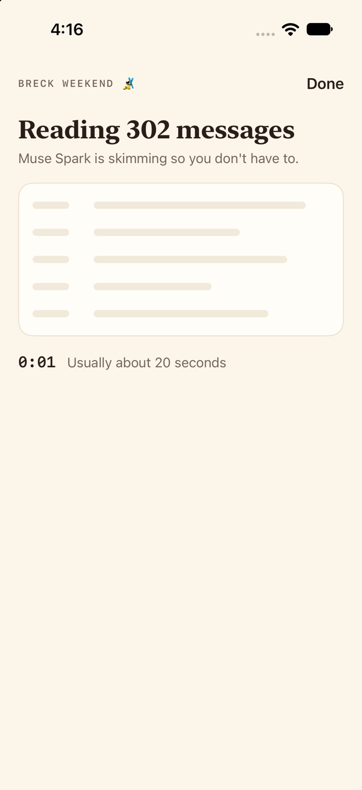
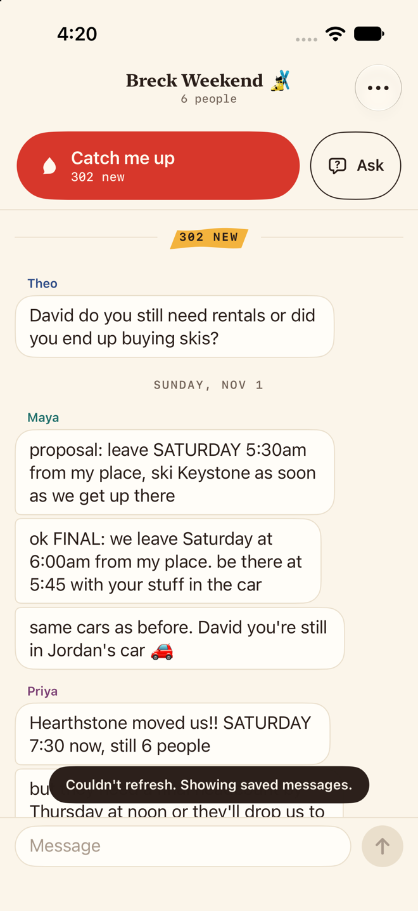
</p>

- **Bars are hairline paper** (`rule`). Their bubbles are card paper with a hairline, like the real ones; mine are plain hairline paper. Rows keep the real heights at every text size, so nothing jumps when they land, and the real rows fade in (`Motion.fade`).
- **It breathes, it doesn't shimmer:** a slow opacity pulse, since a shimmer band would be a gradient. With Reduce Motion it holds still.
- **Offline,** a chat opens on its kept copy and the toast says "Couldn't refresh. Showing saved messages."

## Saved catch-ups

Each chat's last 3 catch-ups and last 3 Ask answers stay on the phone (`Store/SavedBriefs.swift`), so they can be read again with no network call. `Saved/SavedCatchUps.swift` lays them out. Screenshots: `screens/speed/saved-*`.

<p>
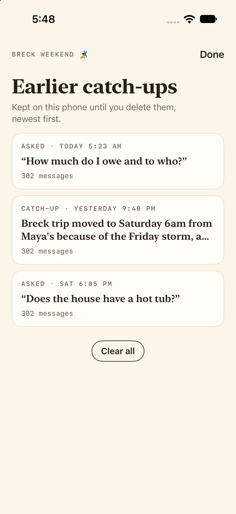
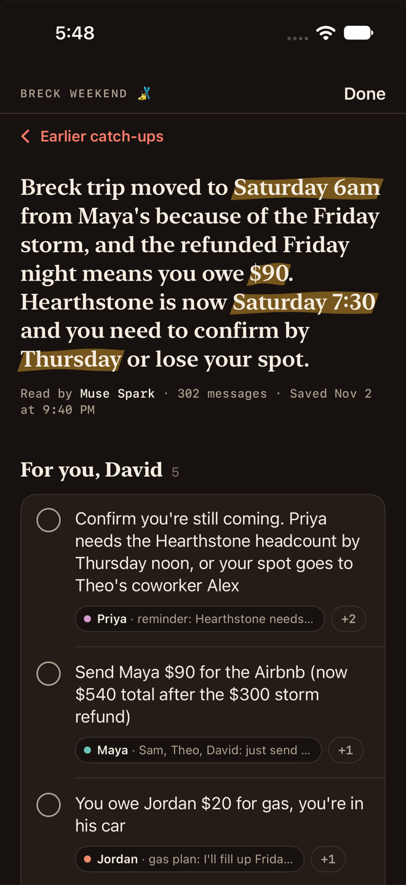
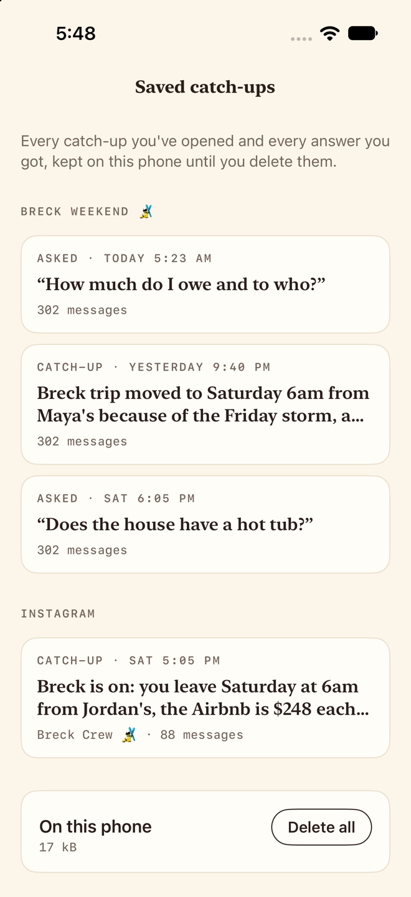
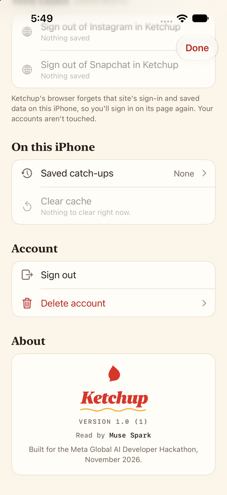
</p>

| Piece | What it does |
|---|---|
| `SavedBriefsSheet` | A chat's (or a web page's) "Earlier catch-ups", from its … menu or the row under a catch-up: paper rows newest first, then one opened in place with "‹ Earlier catch-ups" over it and "Delete from this phone" under it. Swipe or long-press a row to delete; Clear all asks first. |
| `EarlierCatchUpsRow` | Under a chat's catch-up (new, kept, or a failed call): a paper row with the clock icon, "Earlier catch-ups" and what's kept in mono ("3 catch-ups and 1 answer"). Opens `SavedBriefsSheet` as a sheet over the brief; a source in it closes both and jumps. Only shows when something besides the catch-up on screen is kept. |
| `SavedBriefRow` | Kicker "Catch-up · Yesterday 9:40 PM" or "Asked · …", the gist's first sentence or the question in New York, and "302 messages" in mono (a web row adds its thread's name). |
| `SavedQuoteCard` | A source the chat doesn't have loaded (or a web thread's), shown as it was kept: monogram, name in their color, when, the text, "Kept on this phone with the catch-up." |
| `SavedCatchUpsView` | Every chat's saved catch-ups, pushed from Settings: a kicker per chat, the same rows, then the room they take and Delete all. |
| `SavedCatchUpsRow`, `ClearCacheRow` | Settings' two rows under "On this iPhone": the count, with the list behind it; Clear cache with its size ("4.2 MB: your inbox, recent messages and photos. Saved catch-ups stay."). |

- **The byline says when:** "Read by Muse Spark · 302 messages · Saved Nov 2 at 9:40 PM".
- **Sources still trace back.** A chip jumps to the message when the chat has it loaded; otherwise it opens the message as kept.
- **Deleting says what it means:** "They're only on this phone, so they can't come back."
- **Nothing new isn't a blank page.** With nothing unread, the chat's bar offers "Your catch-up" when one is kept, and Catch me up opens it under `NothingNewNote` instead of asking Muse Spark again. "You're all caught up" is for a chat with nothing kept.

## Web chats (Instagram and Snapchat)

Experimental and not released. `WebChatTab(source:)` (`ios/Ketchup/WebChat/`) is one tab of the signed-in home per app: the site's own web page under a slim bar, and Catch me up for the thread that's open. Snapchat only runs its computer version, so its page is laid out 1024 points wide and shrunk to fit; pinch to zoom. Screenshots: `screens/webchat/` (the synthetic test threads, made-up people).

<p>


</p>

| Piece | What it does |
|---|---|
| `WebChatBar` | The site's name in New York, back and a … menu on the right. A hairline under it. Done only when the page is shown full screen. |
| The Catch me up circle | The page's one ketchup thing: a small ketchup circle with the drop, floating on the right edge just above the site's message box, so it covers little of the chat. VoiceOver calls it "Catch me up". It's a menu of the last 10, 30, 80 or 120 messages, since the site doesn't say what's unread, and under a divider, nearest the circle, "Until I stop scrolling". While a Last N read runs, it opens into a pill with a spinner and "Reading the chat". |
| `FollowingPanel` | "Until I stop scrolling" while it reads: a paper card over the bottom of the page, in place of the circle and over the site's message box (nobody types then). The drop, the kicker "UNTIL I STOP SCROLLING" over "Reading the chat" in New York, the count in mono on the right ("42 messages", rolling up as it grows; under the title when that doesn't fit), the Android line ("Scroll up through the chat. Cetchup reads as you go and catches you up when you stop."), then a compact ketchup "Catch me up now" and an outline "Stop". It takes touches only on itself, so the page around it scrolls as usual, and it stops growing at the first accessibility text size. It rises in with `Motion.settle`. The … menu waits while it's up. |
| `WebChatIntro` | First visit only: a paper card that says plainly what happens (sign in on the site's own page, only the open chat, only on tap, your friends' messages go to Muse Spark, the catch-up stays on this phone and never on Ketchup's server), plus the site's own note when it needs one (Snapchat: its computer page, shrunk to fit), with a ketchup "Got it". |
| `WebChatSheet` | The same pieces as a chat's catch-up: `SheetBar`, `SkimmingView` on the thread's own messages, `CatchUpContent`, `AIErrorCard`, and Ask's `NotepadField` and `AnswerCard`. The byline names the source ("88 Instagram messages"); a quiet footer says what it covered. |
| `WebQuoteCard` | A source chip can't jump into the site, so it opens the whole message: the sender's monogram and color, the text, "About Sat 9:15 PM", "Kept on this phone with the catch-up." |

- **The site's own page is the site's.** Cetchup doesn't restyle or touch it; its own chrome stays cream, ink and one ketchup pill.
- **Following never moves the page.** The person scrolls; the panel only counts. Stop, or leaving the tab or the app, ends it with nothing sent.

## Settings

Settings (`ios/Ketchup/People/`) is a sheet from the You tab. Screenshots: `screens/people/`.

<p>
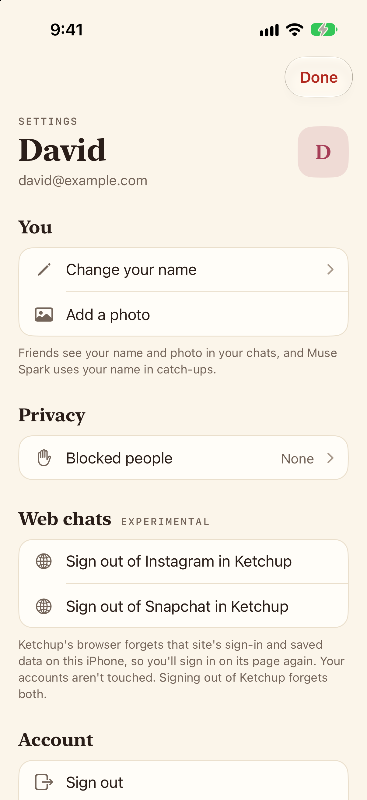
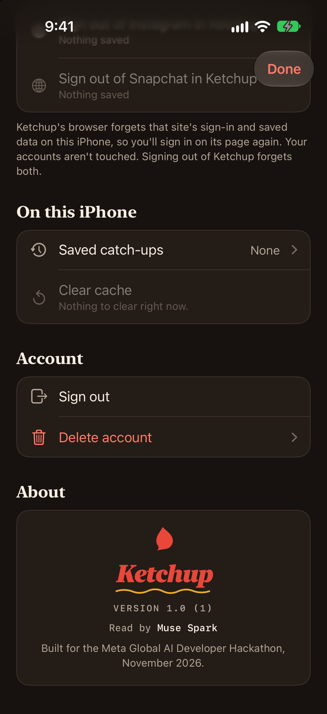
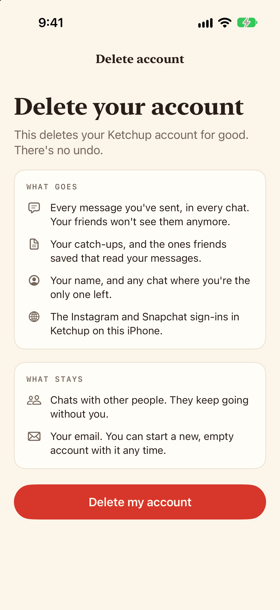
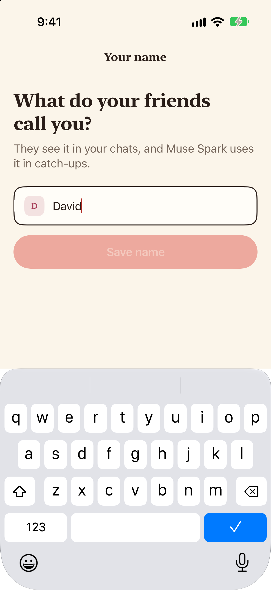
</p>

| Piece | What it does |
|---|---|
| `SettingsSection("You", kicker:footer:)` | A `SectionTitle` (and a kicker, under it when both don't fit) over rows on one `paperCard`, hairlines between them. Rows that draw nothing take no room, and a section with no rows doesn't show, so a slot can sit empty. |
| `SettingsRow(_:systemImage:value:detail:destructive:chevron:)` | One row: an `inkSoft` icon, the label, a value on the right, or a `detail` line under a long label ("Nothing saved"). `destructive` is `ketchupText` (Delete account). At accessibility sizes the value goes under the label. Use it as a button's or link's label with `.pressable`. |
| The header | `AccountHeader`: a "Settings" kicker over your name in New York and your email, with your photo (or monogram) on the right. The You tab uses it with how many chats you're in as the kicker. |
| About | A colophon on paper: the drop, the `Wordmark`, the version in a kicker, `MuseByline`, and the hackathon line. |

- **Settings has no ketchup button.** Delete account is the one red row; its page has the one ketchup button, "Delete my account", and a system alert asks once more.
- **Say what happens.** The delete page lists what goes and what stays; the web-chat rows say "Nothing saved" or "Signed out"; Sign out says it forgets the Instagram and Snapchat sign-ins too.
- **Nothing closes halfway.** While a delete works, its page has no Back and Settings' Done waits.

### Profiles, Block and Report

A profile opens from a name or photo in the thread (a sheet) or a member in Chat info (pushed). It's built from the same sections and rows as Settings.

<p>
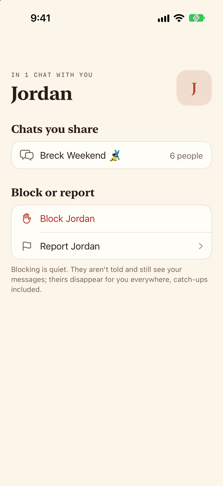
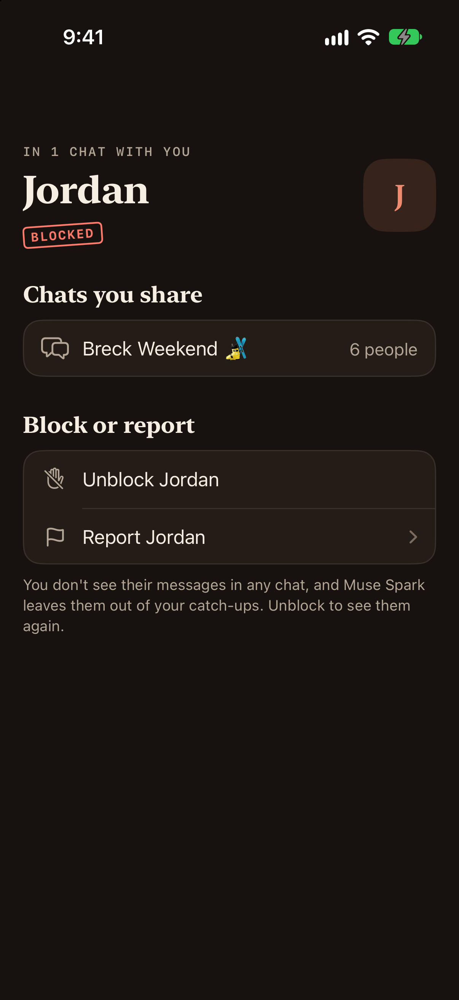
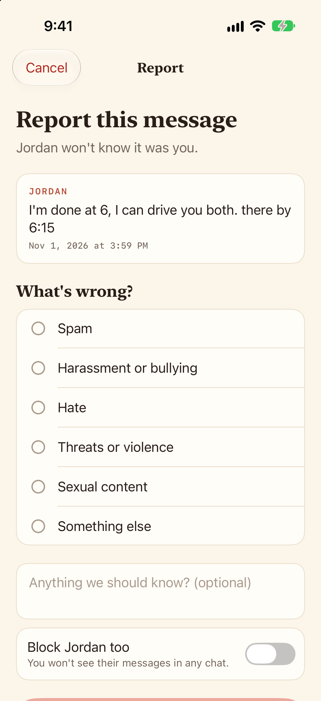
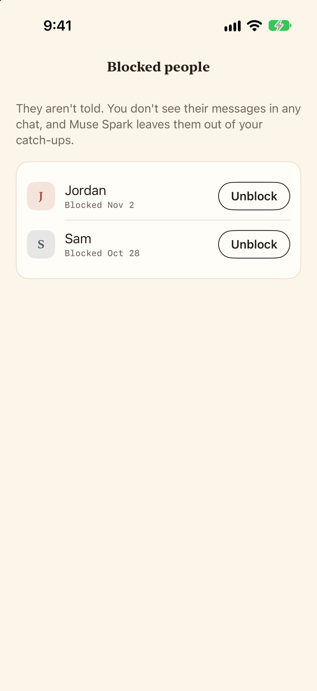
</p>

| Piece | What it does |
|---|---|
| `ProfileView(person:in:onBlockChange:)` | Header like Settings' (a kicker, the name in New York, their `Avatar`), Chats you share, then Block or report. Blocked shows a ketchup `Stamp("Blocked")`. `ProfileSheet` is the same with Done, for the thread. |
| `ReportView(target:)` | The message on paper under the sender's name kicker, What's wrong? (one choice, an ink check), an optional note, "Block them too", and the one ketchup button, Send report. Then a thank-you with the drop. `ReportSheet` adds Cancel. |
| `BlockedPeopleView` | Each blocked person with their avatar, when, and an outline Unblock. |
| `SenderName` | The name over a run of bubbles; a button to their profile when there's one to open. |

- **Block is red, Report isn't.** Block is the destructive row; Report is ink with a flag and opens a page.
- **Say who's told.** Every block and report screen says it plainly: they aren't told, they won't know it was you.
- **In Chat info,** a blocked member gets a ketchup "Blocked" kicker, and everyone but you has a chevron.

### Your people and Invite friends

<p>
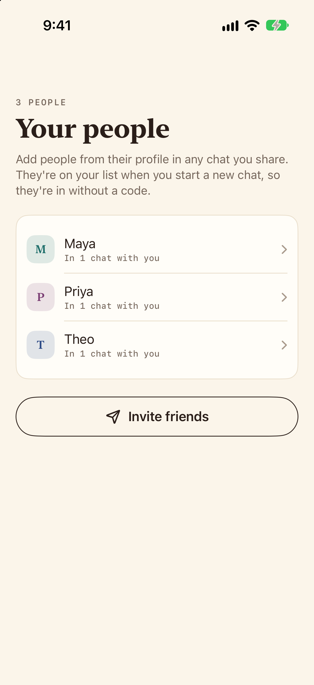
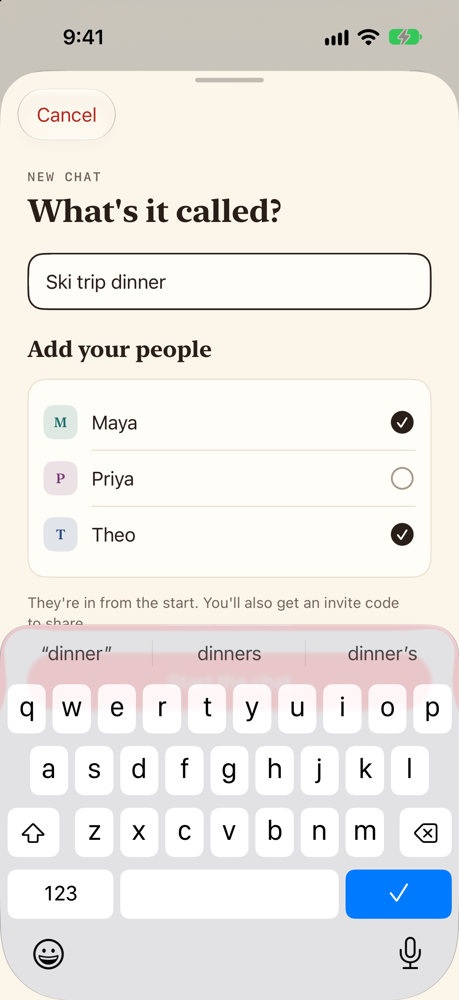
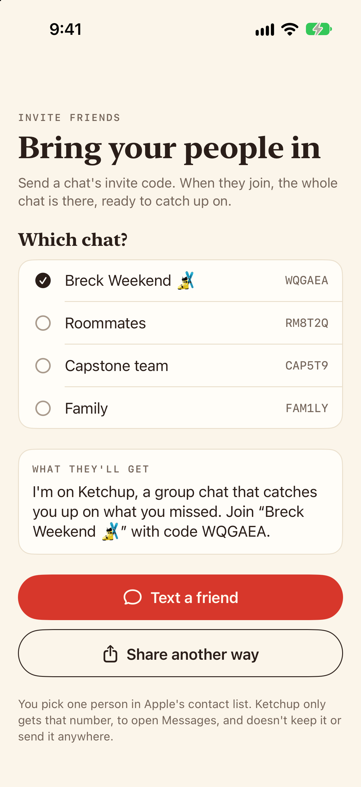
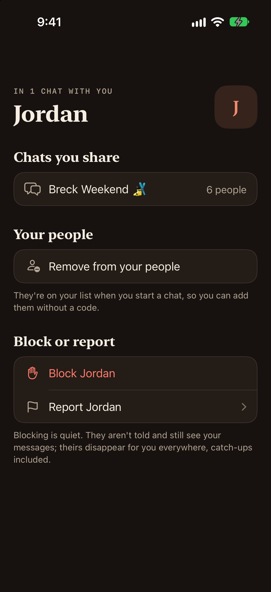
</p>

| Piece | What it does |
|---|---|
| `PeopleView` | A kicker count over "Your people" in New York, then each person's avatar, name and "In 2 chats with you" in mono, with a chevron to their profile. An outline Invite friends under it. |
| `PeoplePicker(people:picked:)` | Your people with an ink check each, for New chat. |
| `InviteView` | Which chat (one ink check, its code in mono), the exact message on paper under "What they'll get", Text a friend (the one ketchup button) and an outline Share another way, and a footnote on what Cetchup sees. |

- **Say what's shared.** The invite page names what Cetchup gets from the contact picker: the one number, used once.

## Plans

The plans are a menu on the counter (`ios/Ketchup/Plans/`): three paper cards with the dish on the left, a dotted leader, and the price on the right as the biggest number on the card. Screenshots: `screens/plans/`.

<p>
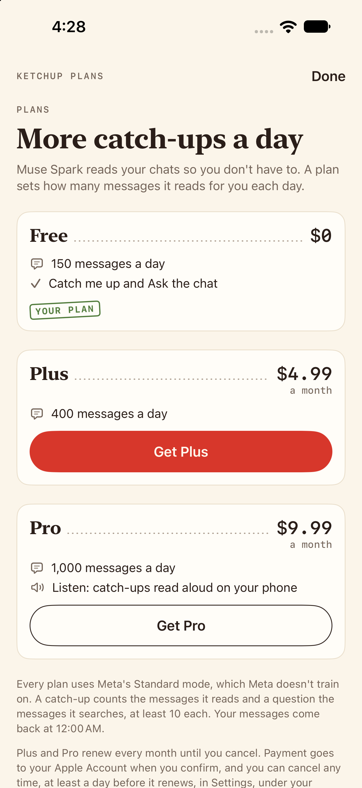
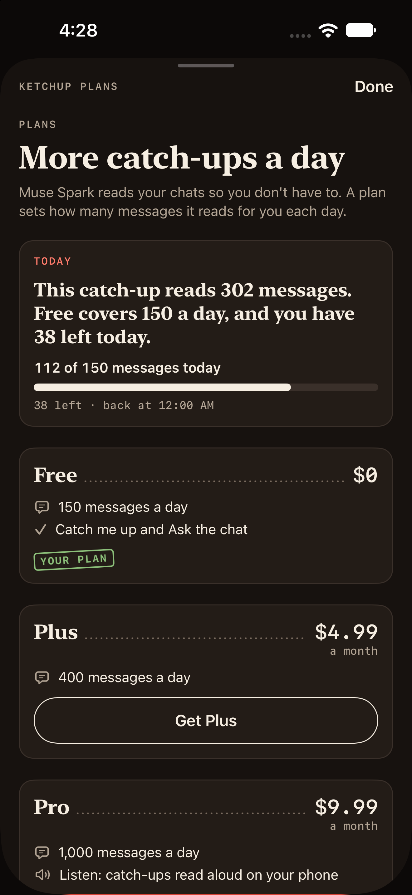
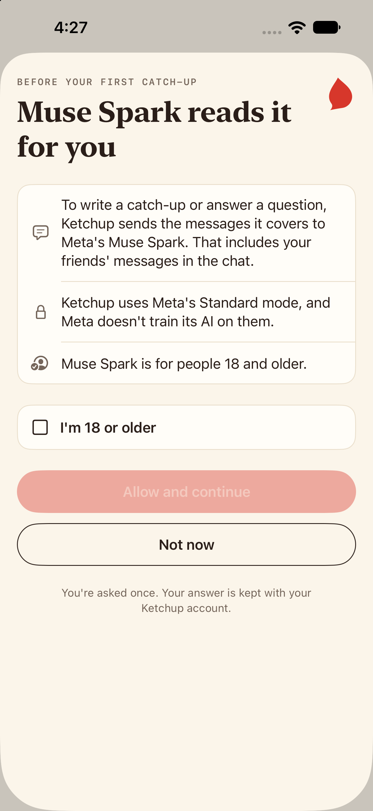
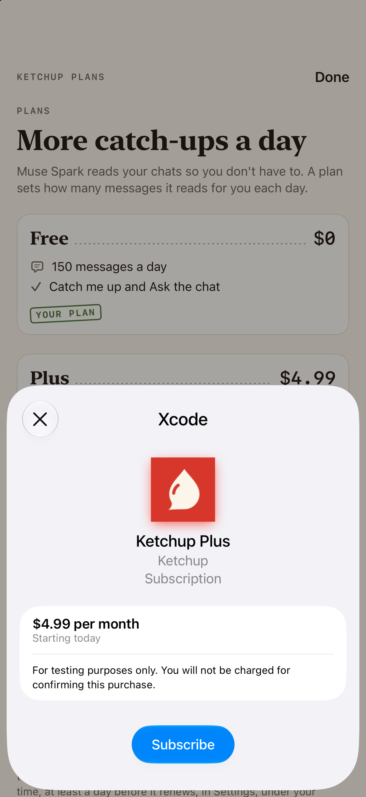
</p>

| Piece | What it does |
|---|---|
| `PaywallView` | "More catch-ups a day" in New York, then a card per plan: its messages a day (Pro adds Listen), the price from the App Store (the list price until it answers), and a pickle `Stamp("Your plan")` on yours. The plan worth getting next has the one ketchup button; the other is outline. Restore purchases, the renewal terms and Terms of Use under the cards. |
| `PaywallSheet` | The same with `SheetBar("Cetchup plans")`, over a catch-up the server turned down: a "Today" card first with the server's sentence and the bar. After a purchase, "You're on Plus" with Back to my catch-up. |
| `UsageBar` | "112 of 150 messages today", a hairline track filling with ink (mustard from four fifths, when it matters to you), "38 left · back at 12:00 AM". |
| `PlanSection` | Settings' Plan: "Your plan" with the plans behind it, and the bar, with the Standard-mode line under it. Hidden until the server has plans. |
| `AIConsentSheet` | Asked once: three points on paper (what goes to Muse Spark, friends' messages included; Standard mode, no training; 18 and older), an ink check for "I'm 18 or older", and the ketchup "Allow and continue", which waits for the check. "Not now" sends nothing. |
| `ListenButton` | Pro's outline "Listen" under the byline; Stop while it reads. Free and Plus see a lock and "Pro", and a tap shows the plans. |

- **Say what it costs and where it goes.** The paywall says every plan uses Meta's Standard mode, which Meta doesn't train on, and what a catch-up counts. No "unlock", no "premium".
- **The server's sentence is the copy.** "You've used today's 150 free messages." shows as is, in the error card and on the paywall.

## Voice

- Plain, warm, a little cheeky. **At most one pun per screen.**
- Sentence case, specific labels: "Add to calendar", not "Continue".
- **Never "AI-powered". Never em dashes**; a period or a comma does the job.
- Muse Spark is credited in a byline: "Read by Muse Spark".

## Previews and screenshots

DEBUG builds open any screen on fixture data from the real demo chat (`ios/Ketchup/Debug/Fixtures/`): no sign-in, no network, no Muse Spark calls. The Supabase client and Realtime refuse to connect while previewing.

```bash
xcrun simctl launch --terminate-running-process <udid> com.vibetemp.ketchup -screen chat
```

| `-screen` | Opens |
|---|---|
| `list` | Every name; tap one to open it |
| `design` | This system, live. Add `-section brand`, `buttons`, `marker`, `type`, `people`, `paper` or `colors` to scroll there |
| `signin`, `signin-code`, `name`, `home`, `home-instagram`, `home-snapchat`, `home-you`, `inbox`, `inbox-loading`, `inbox-empty`, `new-chat`, `join`, `chat`, `chat-loading`, `chat-kept`, `chat-jump`, `chat-joined`, `info`, `icon` | The chat screens (`Debug/CorePreviewScreen.swift`). `chat-joined` is the end of Breck, read through Maya's goodnight, then Rowan (made up) joins and says hi: "Rowan joined" under "1 new" (`Debug/JoinedPreview.swift`). `home` opens the tabs on Chats (the same screen as `inbox`); `home-instagram`, `home-snapchat` and `home-you` open on those tabs, the web ones on their synthetic test threads, offline (add `-KetchupInstagramFixture NO` for the real site, `-webchat.instagram.introSeen YES` to skip the first-visit card). `-openChat YES` opens Breck 1.2 s in, so the tab bar steps aside. `inbox-loading` and `chat-loading` are the skeletons; `chat-kept` opens Breck on a copy kept on the phone with no server. `chat-jump` stages the jump-to-message highlight; `icon` renders the app icon. `-reduceMotion YES` works here too, and `-send "on my way"` sends that 1.2 s in on the chat screens |
| `ai-catchup`, `ai-checked`, `ai-loading`, `ai-loading-blank`, `ai-error`, `ai-empty`, `ai-ask`, `ai-ask-loading`, `ai-ask-error`, `ai-answer`, `ai-notfound` | The Muse Spark screens (`Debug/AIPreviewScreen.swift`). `ai-loading-blank` is the skim before the thread's messages are here. Add `-section for-you`, `plans`, `owes`, `questions` or `highlights` to scroll the brief there, `-delay 4` to land it late, `-reduceMotion YES` to see the Reduce Motion version |
| `saved`, `saved-brief`, `saved-empty`, `saved-quote`, `saved-all` | Saved catch-ups (`Debug/SavedPreviewScreen.swift`) on a scratch store: Breck's Earlier catch-ups, opened on its catch-up, empty, a source shown as kept, and every chat's list in its Settings bar |
| `brief-history`, `brief-nothing-new`, `brief-chat` | The catch-up sheet with Breck's last 3 catch-ups kept (`Debug/SavedPreviewScreen.swift`): Earlier catch-ups over a new catch-up; Catch me up with nothing new since the last one (add `-section earlier` for the row under it); and the thread, all read, with "Your catch-up" in its bar |
| `store-check` | Not a screen: runs the on-device copy and saved catch-ups (`Store/DeviceStore.swift`) against a scratch folder and lists what passed (`Debug/StoreCheckScreen.swift`) |
| `web-instagram`, `web-snapchat`, `web-intro`, `web-reading`, `web-brief`, `web-error`, `web-quote` | The web-chat screens (`Debug/WebChatPreviewScreen.swift`) on the synthetic threads. `web-instagram` and `web-snapchat` are each page on its bundled fixture; `web-brief` is a hand-written brief, not a Muse Spark call |
| `settings`, `settings-sheet`, `settings-name`, `settings-delete`, `settings-blocked`, `profile`, `profile-blocked`, `report`, `report-sent`, `info-blocked`, `chat-profile`, `chat-report`, `people`, `people-empty`, `profile-contact`, `new-chat-people`, `invite` | Settings and the people screens (`Debug/PeoplePreviewScreen.swift`), on the demo chat's made-up friends. `settings` is full screen (add `-section web`, `account` or `about`); `settings-sheet` is the sheet as the You tab opens it; `chat-profile` and `chat-report` open over the Breck thread. `-renameTo Dave` here (and `-leave YES` on `home`) acts 1.2 s in; add `-serverRefuses YES` for the way back |
| `paywall`, `plan-free-usage`, `plan-limit-hit`, `consent`, `plan-listen` | Plans (`Debug/PlansPreviewScreen.swift`): the paywall on Free with 112 of 150 used; Settings with the Plan section; Breck's 302 unread turned down on Free with the paywall over it; the consent sheet over a catch-up; a Pro catch-up with Listen. On a simulator, `-storekitTest YES` (and the framework path in CLAUDE.md) makes the paywall buy through Xcode's local StoreKit test, `-buy plus` presses Get Plus |
| `photo-crop`, `photo-inbox`, `photo-chat`, `photo-info`, `photo-thread`, `photo-sending`, `photo-attach`, `photo-viewer`, `photo-catchup`, `photo-answer` | Photos (`Debug/PhotosPreviewScreen.swift`): the cropper on a made-up mountain photo; the inbox, the Breck thread and its members with made-up profile photos (`Debug/PreviewPhotos.swift`; Sam has none, to show the monogram); the end of Breck with photos in it, David's photo uploading (a pretend 20 s upload), one waiting in the composer, and the viewer on Maya's cabin; `photo-catchup` (add `-section highlights`) and `photo-answer` cite Maya's door-code photo with its thumbnail |

Light and dark screenshots:

```bash
xcrun simctl ui <udid> appearance dark
xcrun simctl launch --terminate-running-process <udid> com.vibetemp.ketchup -screen ai-catchup
xcrun simctl io <udid> screenshot ai-catchup-dark.png
```

The foundation set is in `docs/screens/foundation/` (the old purple screens, kept as the "before"); the redesigned screens are in `docs/screens/redesign/` (chat screens and `ai-*` Muse Spark screens, light and dark, plus Extra Extra Large text). To add a screen, add a case to the `Screen` enum in one of the two preview files (`ai-` names go in the Muse Spark one) and `list` picks it up. Build its data with `PreviewData.app()` and `PreviewData.chatModel(catchUp:answer:delay:asked:)`.
