# Ketchup design

Ketchup looks like a diner counter: cream paper, warm ink, and one squeeze of ketchup red for the thing to press. Mustard marks what matters to you (a time, an amount, your name), pickle green stamps what's confirmed, plans arrive as order tickets and money as a diner check.

<p>
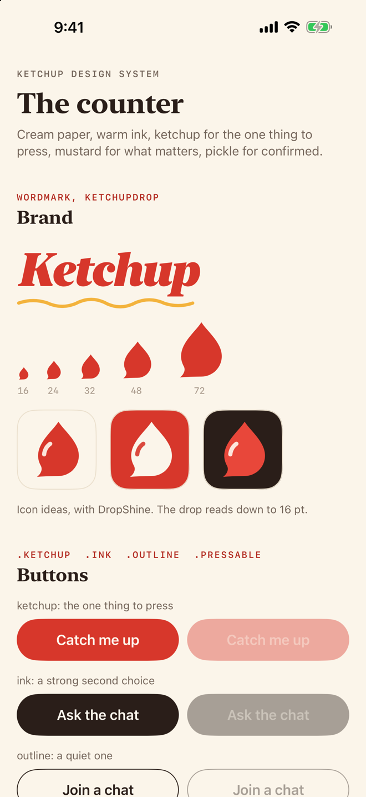
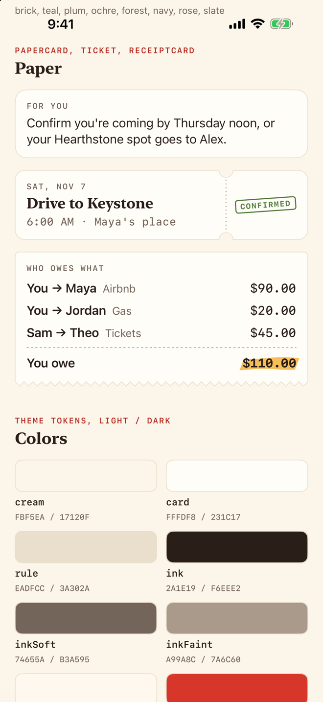
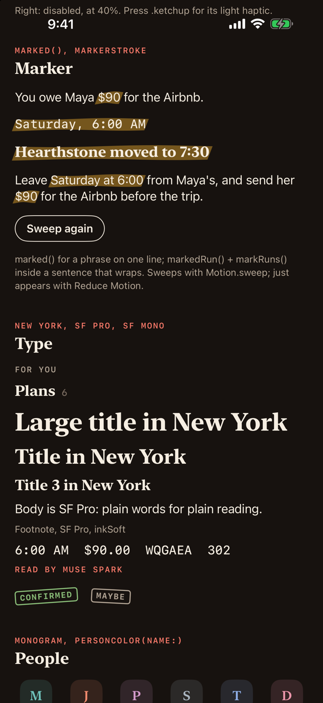
</p>

Code: `ios/Ketchup/Theme.swift` holds colors, type and motion; `ios/Ketchup/Design/` holds the shapes, buttons and labels. Launch a DEBUG build with `-screen design` to see every piece live (recipe at the bottom).

## House rules

- **One ketchup thing per screen.** Everything else is ink, outline or plain text.
- **Mustard means "this matters to you."** Never decoration.
- **No gradients, sparkles, glass, purple or drop shadows.** Paper sits on paper with a 1 pt hairline. One deliberate exception: the top-bar buttons keep iOS's system glass, so they behave like every other iPhone app (David's call, Nov 3, 2026). The rule is about cards, bubbles and bars we draw.
- **Muse Spark gets a byline** ("Read by Muse Spark"), not a sparkle.

## Color

Every token is a light/dark pair made with `Color(light:dark:)` (hex `0xRRGGBB`).

| Token | Light | Dark | Use |
|---|---|---|---|
| `cream` | FBF5EA | 17120F | App background |
| `card` | FFFDF8 | 231C17 | Raised paper: cards, other people's bubbles |
| `rule` | EADFCC | 3A302A | Hairlines, card borders |
| `ink` | 2A1E19 | F6EEE2 | Primary text, my bubbles |
| `inkSoft` | 74655A | B3A595 | Secondary text |
| `inkFaint` | A99A8C | 7A6C60 | Placeholders and decoration only, never text someone must read |
| `onInk` | FFF8EE | 17120F | Text on ink |
| `ketchup` | D7372B | E8473A | Brand red: the logo, the one button |
| `ketchupText` | B22A20 | FF7B6B | Small red text on cream (plain ketchup is too light); the app tint |
| `onKetchup` | FFF8EE | FFF8EE | Text on ketchup |
| `mustard` | F3B33D | E9A92F | Marker, unread badges, jump-to-message highlight |
| `onMustard` | 2A1E19 | 17120F | Text on mustard, both modes |
| `pickle` | 4F7A3A | 8CC07A | Confirmed stamps |

**People:** `Theme.people` has 8 name colors (brick, teal, plum, ochre, forest, navy, rose, slate). `personColor(name:)` gives the demo chat's six people six different colors; prefer it over `personColor(_ id:)` wherever a name shows, so Maya is the same teal in the chat and in Muse Spark's results.

## Type

| Role | Call | Use |
|---|---|---|
| New York | `.font(.serif(.title3))` (bold unless you pass `weight:`) | Headlines, section titles, the wordmark |
| SF Mono | `.font(.mono(.caption2))` (medium) | Times, amounts, codes, counts, kickers |
| SF Pro | `.font(.body)` and friends | Everything else |

Always use text styles so Dynamic Type works. The wordmark is the only fixed size.

## Motion

| Token | Value | Use |
|---|---|---|
| `Motion.snappy` | spring 0.3 s, no bounce | The default |
| `Motion.settle` | spring 0.45 s, no bounce | Bigger moves, content arriving |
| `Motion.lively` | spring 0.4 s, bounce 0.2 | Only something the user flicked or checked |
| `Motion.press` | spring 0.16 s, no bounce | Buttons going down and up |
| `Motion.sweep` | curve (0.23, 1, 0.32, 1), 0.5 s | The marker pass |
| `Motion.squirt` | same curve, 0.9 s | The wordmark's squiggle drawing in |
| `Motion.stagger` | 0.04 s | Gap between items arriving in a list (`Motion.staggered(_:index:)`) |
| `Motion.fade` | ease out 0.2 s | What Reduce Motion gets instead |

**Reduce Motion:** every animated piece checks `accessibilityReduceMotion`. In screens, use `.motion(_:value:)` instead of `.animation(_:value:)` and `.transition(.rise(reduceMotion:))` for things arriving; both turn into a plain fade.

## Components

| Piece | When to use it |
|---|---|
| `KetchupDrop()` | The logo: a ketchup drop with a chat-bubble tail. Fill with `ketchup`; reads from 16 pt up. |
| `DropShine()` | Highlight stacked on a big drop (icon, hero). Skip under about 40 pt. |
| `Wordmark(size:drawIn:)` | "Ketchup" in New York black italic with the mustard squiggle; `drawIn` draws it once. |
| `Squiggle()` | The squirt under the wordmark, or a quiet divider. Works with `.trim`. |
| `.buttonStyle(.ketchup)` | The one thing to press. Full-width red capsule, light haptic on press down. |
| `.buttonStyle(.ink)` / `.outline` | A strong second choice / a quiet one. |
| `.ketchup(.compact)`, `.ink(.compact)`, `.outline(.compact)` | Buttons inside cards ("Add to calendar", "Try again"). |
| `.buttonStyle(.pressable)` | Tappable cards and rows: scale only. |
| `Kicker("For you")` | Small mono caps over a headline or card. |
| `SectionTitle("Plans", count: 6)` | Section heading, a VoiceOver header. |
| `Monogram(name:color:size:)` | Initials on a soft tile of the person's color. Decorative. |
| `Avatar(name:path:size:)` | A person's photo in the monogram's rounded square with a hairline, or their `Monogram` while it loads or when there's none. Use it wherever a person shows. Decorative. |
| `Stamp("Confirmed")` | Rubber stamp on a plan; pickle by default, `inkSoft` and `dashed: true` for "Maybe". |
| `.marked(_:color:sweep:delay:)` | Marker behind a short phrase on one line. |
| `Text("…\(Text("$90").markedRun())…").markRuns(sweep:)` | Marker inside a sentence; follows the words as they wrap. |
| `.paperCard(padding:radius:)` | The default container: card paper, hairline, no shadow. |
| `Ticket { plan } stub: { stamp }` | A plan as an order ticket, parts placed either side of the tear line. Built on `TicketShape`, `PerforationLine` and `.ticketCard()`. |
| `.receiptCard()` | Money, as a diner check with a torn zigzag edge (`ReceiptShape`). |

The old purple names (`Theme.accent`, `aiGradient`, `aiDiagonal`, `aiWash`, `indigo`, `violet`, `pink`, `aiSymbol`, `aiName`) still compile but are deprecated and mapped flat onto this palette. Each warning is a spot still to restyle.

## Pager

After sign-in, the home is three pages side by side: **Chats** (the inbox, first), **Instagram** and **Snapchat** (`ios/Ketchup/Views/HomePager.swift`). Swipe between them or tap a name. The app comes back to the page you were on last (`@AppStorage("home.page")`).

<p>
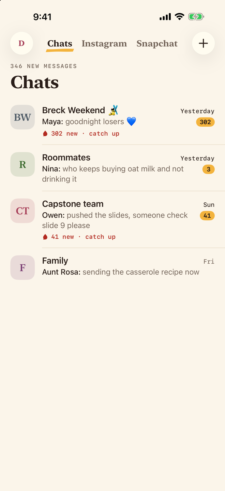
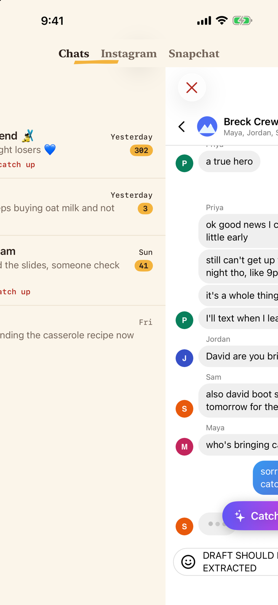
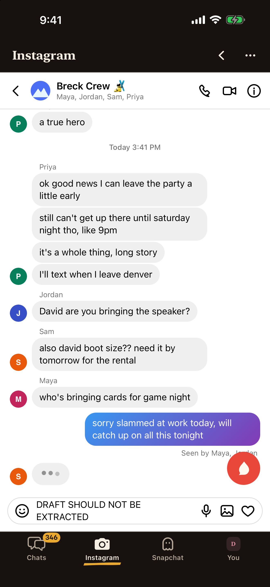
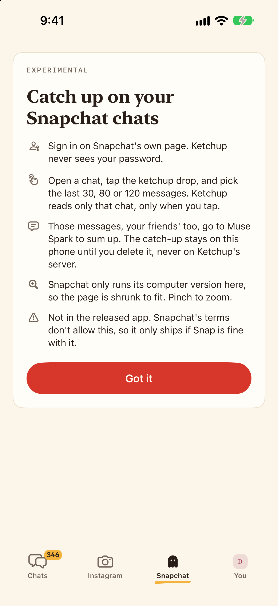
</p>

- **The switcher** sits in the middle of the Chats page's top bar, between its glass buttons: the names in New York, ink for the page you're on, `inkSoft` for the rest, and a mustard `MarkerStroke` under the current one that slides along as the pages scroll. Like a bar title it keeps its size past the default text size (long-press shows it big at accessibility sizes). The other pages leave that row free above their own bar.
- **Paging is the system's** (a paging `ScrollView`). A tap on a name scrolls there with `Motion.settle`, or jumps with Reduce Motion on.
- **In a chat the pages stay put** and the switcher fades out (`Motion.fade`), so the chat's back swipe works and its title takes the middle of the bar. The Chats page says so through `HomePagerState.locked`.
- **Over a web page** a sideways swipe still pages, unless the page can scroll sideways itself (zoomed in, a wide carousel): then the page gets it, and the switcher still works. Vertical scrolling and taps are always the page's. From the left edge the pager wins even when the site could go back; the bar's back button does that.
- **A page is built the first time you head its way**, then kept: a web page doesn't load until you go there, and doesn't reload as you swipe past.
- **`HomePage.all`** lists the pages, left to right, and `HomePage.content` says what each shows: another chat app is one more `.web(…)` in the list.

## Profile photos

A photo is a print pinned to the paper: the same rounded square as a monogram, edged with a hairline. Screenshots: `screens/photos/` (made-up photos, no real people).

<p>
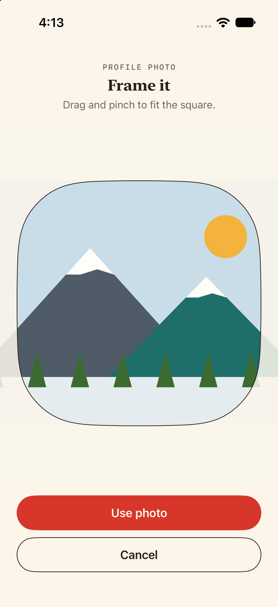
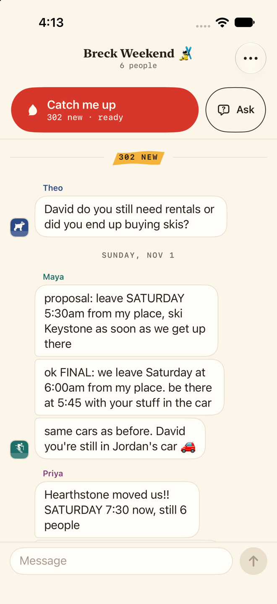
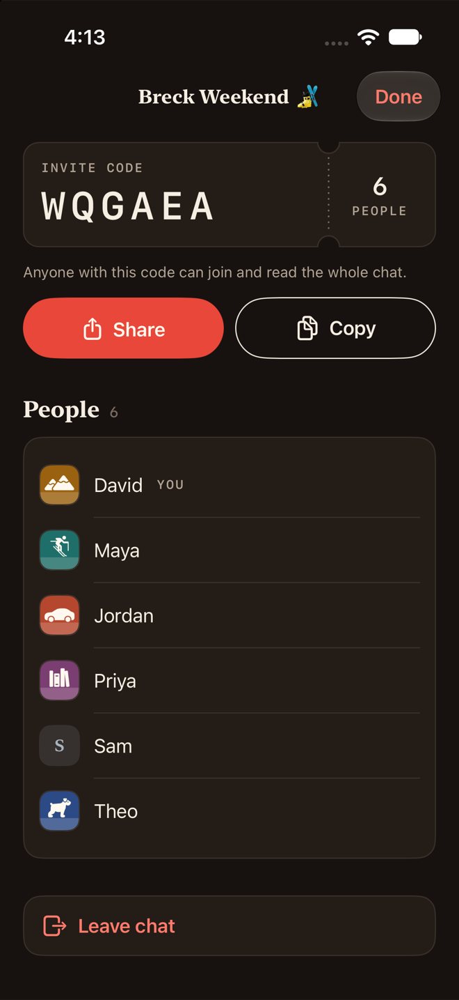
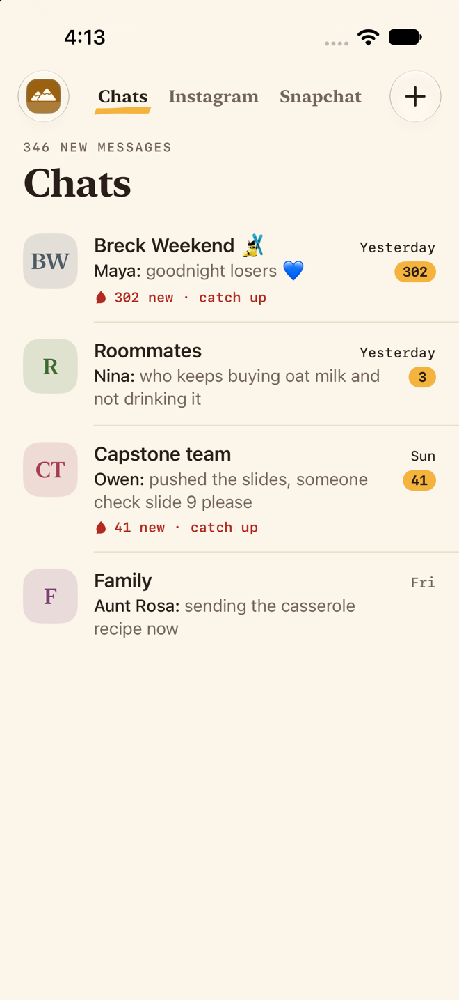
</p>

| Piece | What it does |
|---|---|
| `AvatarCropper` | "Frame it": the picked photo under paper with a rounded-square window cut out; drag and pinch, the photo always covers the window. "Use photo" is the one ketchup button and says "Saving" until the upload is done. VoiceOver can zoom with swipe up and down. |
| In a chat | Other people's photos sit by the last bubble of each run, bottom-aligned, 28 pt. Mine get none. |
| Account button | My photo inside the top bar's glass button. Its menu adds, changes or removes the photo (until Settings takes that over). |

## Muse Spark screens

Catch me up and Ask the chat (`ios/Ketchup/AI/`) lay Muse Spark's JSON out on the counter. Screenshots: `screens/redesign/ai-*`.

<p>
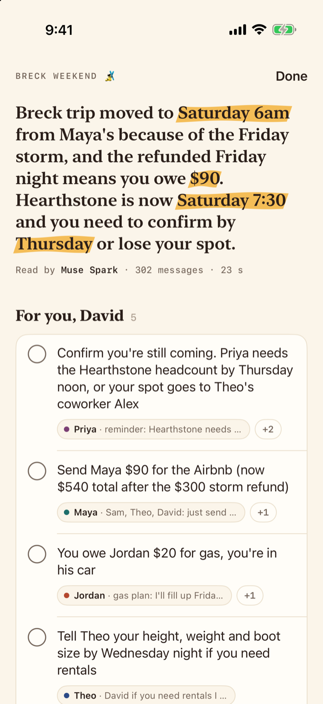
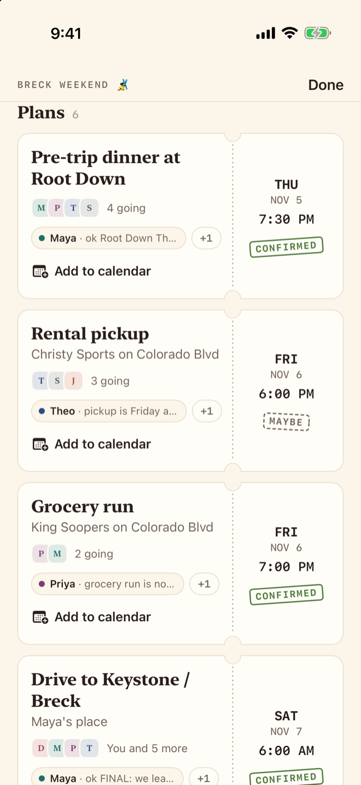
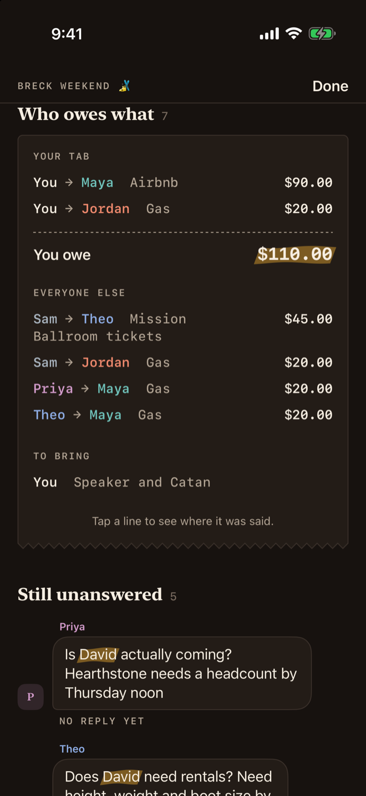
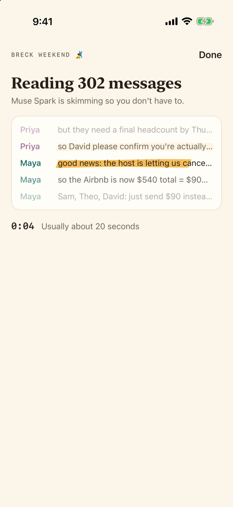
</p>

| Piece | What it does |
|---|---|
| `SheetBar` | The pinned top of both sheets: the chat's name as a running head, and Done. |
| `BriefMarks` | Marks money and times in Muse Spark's sentences ("$90", "Saturday 6am", "by Thursday"; not an old "from $140"), or the reader's name in a question. Show with `.markRuns()`. |
| `MuseByline` | "Read by Muse Spark · 302 messages · 23 s", or "Saved" for a cached brief. |
| `RefChips` | Sources: a dot in the sender's chat color and how the message starts. One chip and a "+2" to a line; a tap jumps to the message. |
| `SkimmingView` | The wait: the real unread messages pass a window while the marker reads each line, an honest clock, "Usually about 20 seconds". A still list with Reduce Motion. |
| `ForYouList` | The reader's to-dos. The circle checks one off with `.struck()`, a pen stroke through the words. |
| `PlanCard` | A `Ticket`: what, where, who, sources and Add to calendar; the stub has day, date, time and the stamp. Soonest first. |
| `OwesCheck` | A `receiptCard()`: your tab first with the total marked as it scrolls in, everyone else, then To bring. |
| `QuestionBubble` | An open question as the asker's message, "No reply yet" under it. |
| `AIErrorCard`, `CaughtUpCard` | A failed call with Try again; nothing new, with the drop. |

- **Everything traces back.** A chip, a line on the check, a bubble or a to-do's words closes the sheet onto that message.
- **The reader is "You"**, in ink; everyone else is in `personColor(name:)`, as in the chat.
- **Mustard only on what's the reader's**: the times and money in the gist and in answers, their name in questions, their total.

## Web chats (Instagram and Snapchat)

Experimental and not released. `WebChatTab(source:)` (`ios/Ketchup/WebChat/`) is one page of the signed-in home per app: the site's own web page under a slim bar, and Catch me up for the thread that's open. Snapchat only runs its computer version, so its page is laid out 1024 points wide and shrunk to fit; pinch to zoom. Screenshots: `screens/webchat/` (the synthetic test threads, made-up people).

<p>
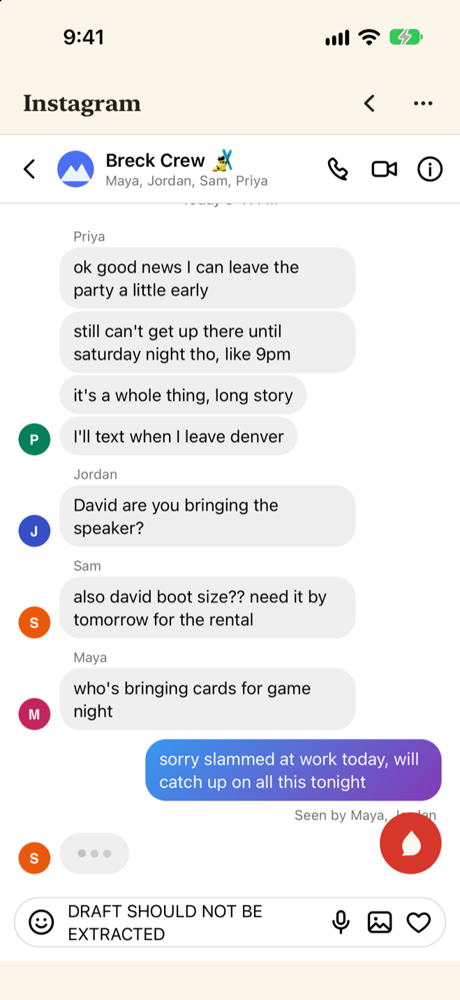
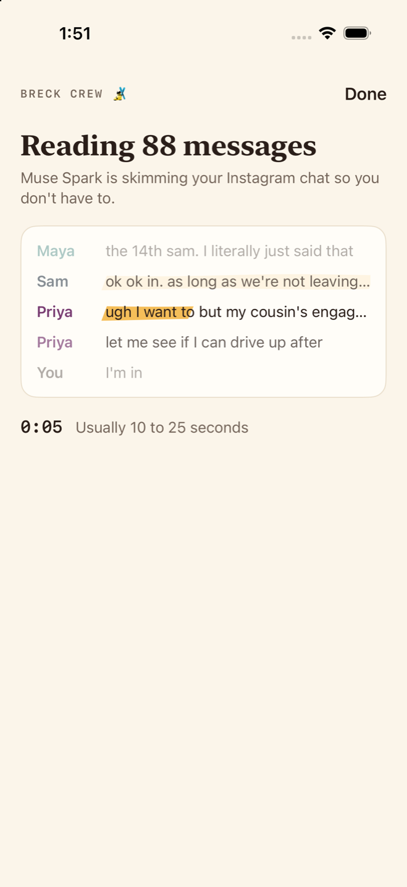
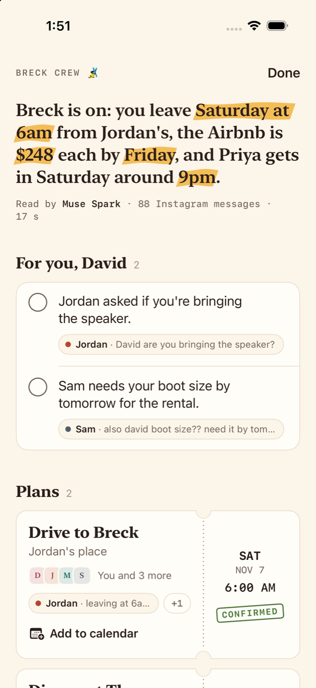
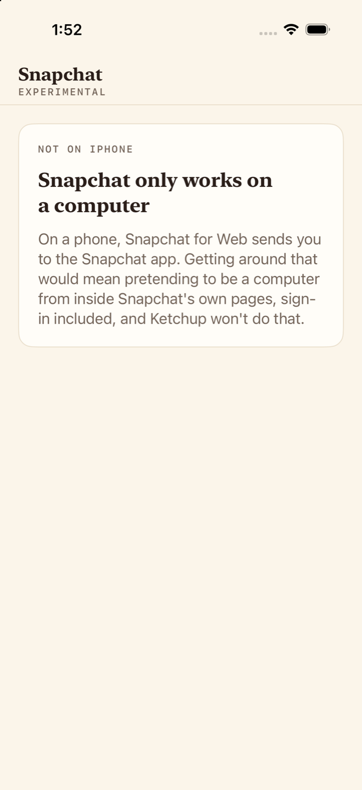
</p>

| Piece | What it does |
|---|---|
| `WebChatBar` | The site's name in New York, `Kicker("Experimental")` under it, back and a … menu on the right. A hairline under it. Done only when the page is shown full screen. |
| The Catch me up pill | The page's one ketchup thing, floating over the site: the drop, "Catch me up", and "Last 30, 80 or 120 messages" in mono. It's a menu, since the site doesn't say what's unread. While it reads: "Reading the chat", "Scrolling back for older messages". |
| `WebChatIntro` | First visit only: a paper card that says plainly what happens (sign in on the site's own page, only the open chat, only on tap, your friends' messages go to Muse Spark, nothing saved, not released), plus the site's own note when it needs one (Snapchat: its computer page, shrunk to fit), with a ketchup "Got it". |
| `WebChatSheet` | The same pieces as a chat's catch-up: `SheetBar`, `SkimmingView` on the thread's own messages, `CatchUpContent`, `AIErrorCard`, and Ask's `NotepadField` and `AnswerCard`. The byline names the source ("88 Instagram messages"); a quiet footer says what it covered and that it's experimental. |
| `WebQuoteCard` | A source chip can't jump into the site, so it opens the whole message: the sender's monogram and color, the text, "About Sat 9:15 PM", "Not saved". |

- **The site's own page is the site's.** Ketchup doesn't restyle or touch it; its own chrome stays cream, ink and one ketchup pill.
- **"Experimental" is said, not shouted:** a kicker under the name, a line in the footer.

## Voice

- Plain, warm, a little cheeky. **At most one pun per screen.**
- Sentence case, specific labels: "Add to calendar", not "Continue".
- **Never "AI-powered". Never em dashes**; a period or a comma does the job.
- Muse Spark is credited in a byline: "Read by Muse Spark".

## Previews and screenshots

DEBUG builds open any screen on fixture data from the real demo chat (`ios/Ketchup/Debug/Fixtures/`): no sign-in, no network, no Muse Spark calls. The Supabase client and Realtime refuse to connect while previewing.

```bash
xcrun simctl launch --terminate-running-process <udid> com.vibetemp.ketchup -screen chat
```

| `-screen` | Opens |
|---|---|
| `list` | Every name; tap one to open it |
| `design` | This system, live. Add `-section brand`, `buttons`, `marker`, `type`, `people`, `paper` or `colors` to scroll there |
| `signin`, `signin-code`, `name`, `home`, `home-instagram`, `inbox`, `inbox-empty`, `new-chat`, `join`, `chat`, `chat-jump`, `info`, `icon` | The chat screens (`Debug/CorePreviewScreen.swift`). `home` opens the pager on Chats (the same screen as `inbox`), `home-instagram` on the Instagram page with the synthetic test thread, offline (add `-KetchupInstagramFixture NO` for the real site). `chat-jump` stages the jump-to-message highlight; `icon` renders the app icon |
| `ai-catchup`, `ai-checked`, `ai-loading`, `ai-error`, `ai-empty`, `ai-ask`, `ai-ask-loading`, `ai-ask-error`, `ai-answer`, `ai-notfound` | The Muse Spark screens (`Debug/AIPreviewScreen.swift`). Add `-section for-you`, `plans`, `owes`, `questions` or `highlights` to scroll the brief there, `-delay 4` to land it late, `-reduceMotion YES` to see the Reduce Motion version |
| `web-instagram`, `web-snapchat`, `web-intro`, `web-reading`, `web-brief`, `web-error`, `web-quote` | The web-chat screens (`Debug/WebChatPreviewScreen.swift`) on the synthetic threads. `web-instagram` and `web-snapchat` are each page on its bundled fixture; `web-brief` is a hand-written brief, not a Muse Spark call |
| `photo-crop`, `photo-inbox`, `photo-chat`, `photo-info` | Profile photos (`Debug/PhotosPreviewScreen.swift`): the cropper on a made-up mountain photo, then the inbox, the Breck thread and its members with made-up photos (`Debug/PreviewPhotos.swift`). Sam has none, to show the monogram |

Light and dark screenshots:

```bash
xcrun simctl ui <udid> appearance dark
xcrun simctl launch --terminate-running-process <udid> com.vibetemp.ketchup -screen ai-catchup
xcrun simctl io <udid> screenshot ai-catchup-dark.png
```

The foundation set is in `docs/screens/foundation/` (the old purple screens, kept as the "before"); the redesigned screens are in `docs/screens/redesign/` (chat screens and `ai-*` Muse Spark screens, light and dark, plus Extra Extra Large text). To add a screen, add a case to the `Screen` enum in one of the two preview files (`ai-` names go in the Muse Spark one) and `list` picks it up. Build its data with `PreviewData.app()` and `PreviewData.chatModel(catchUp:answer:delay:asked:)`.
