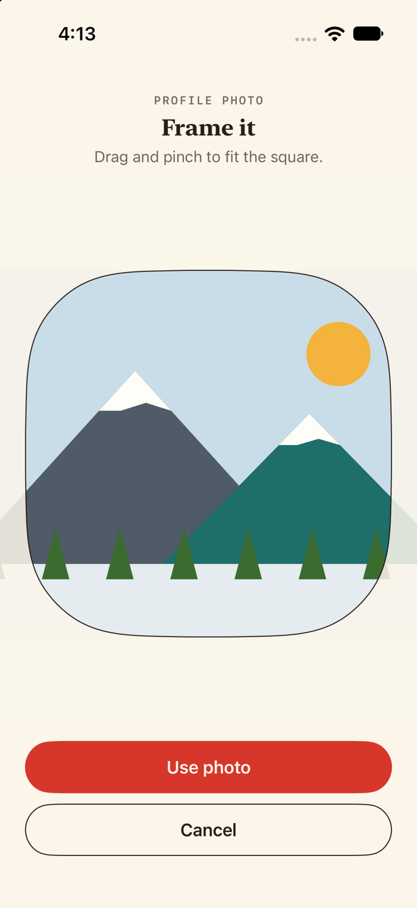
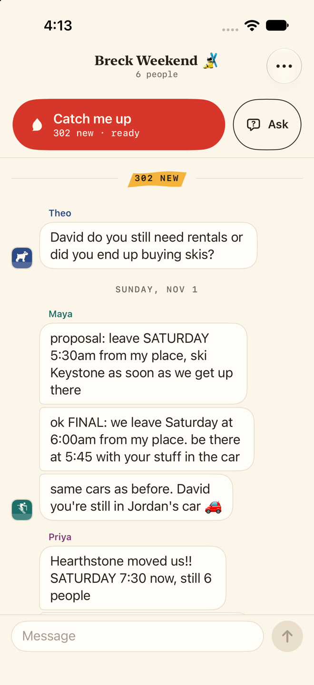
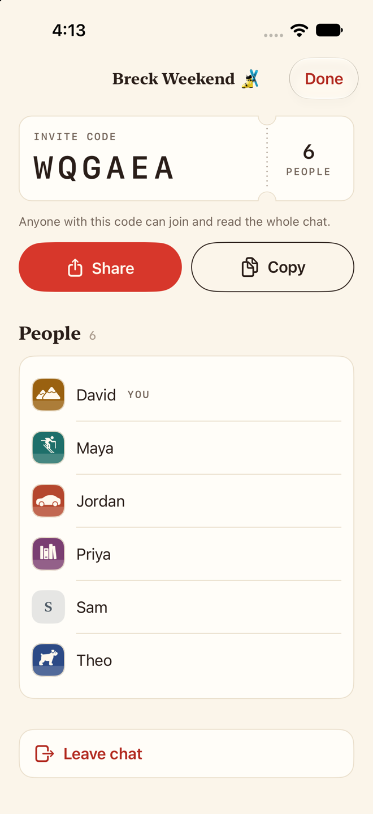
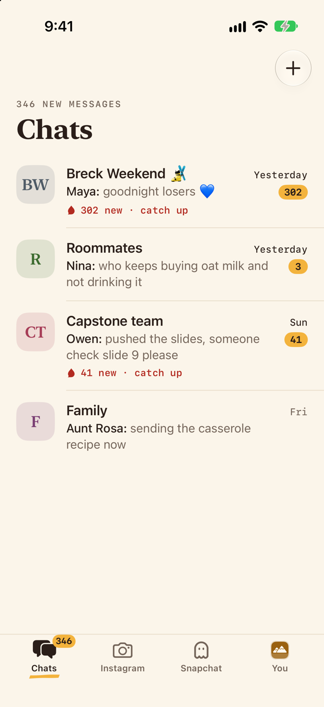
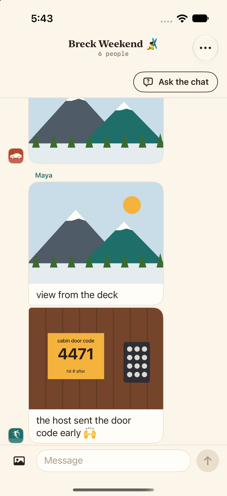
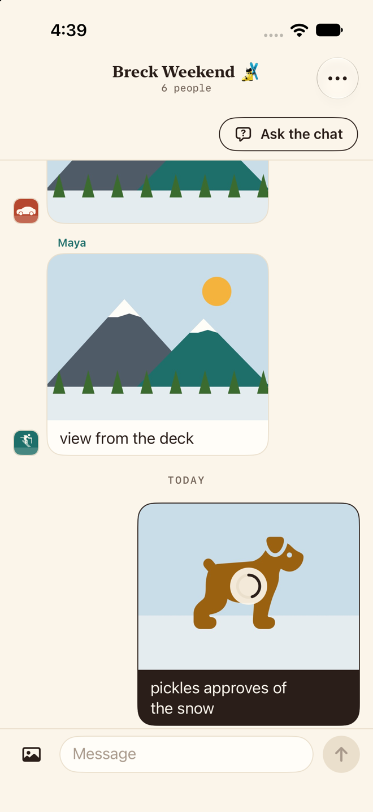
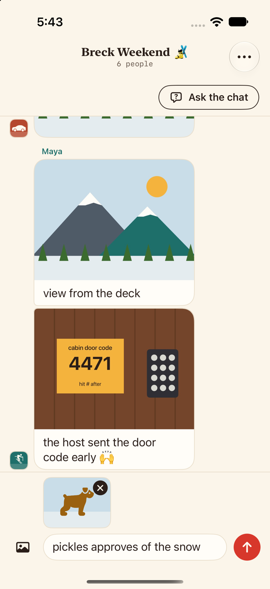
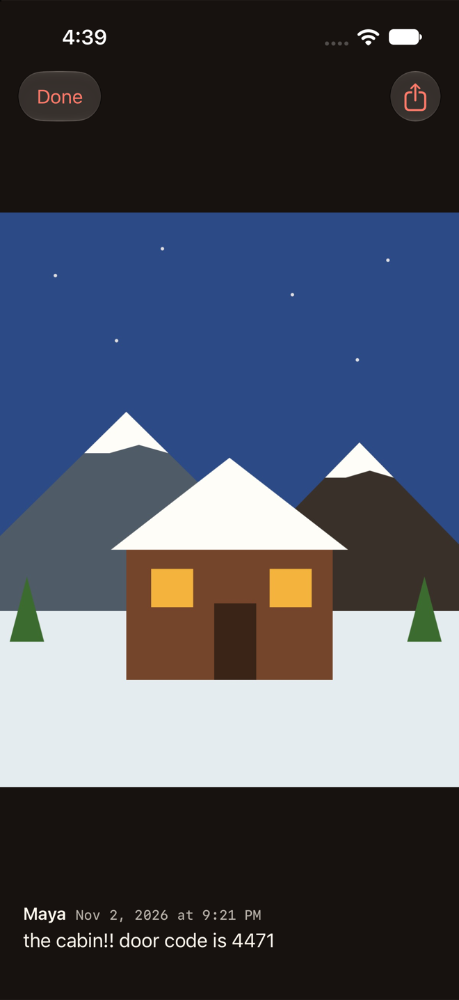
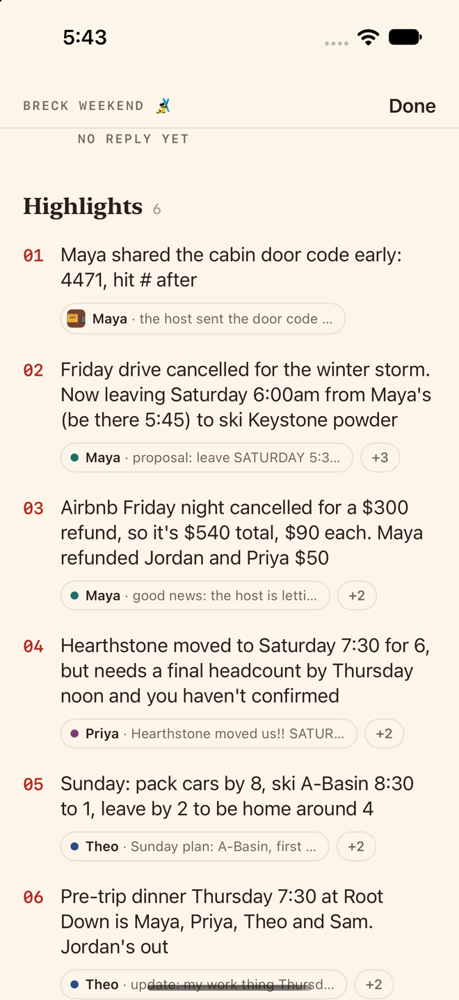
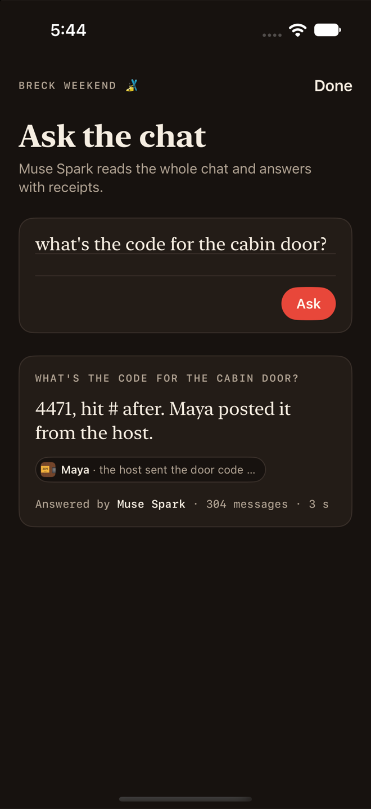

# Photos

Photos on the diner-counter design system (`docs/DESIGN.md`): framing a new profile photo, profile photos wherever a person shows, and photos sent in a chat. Taken on an iPhone 17 Pro simulator from the offline previews (`-screen photo-…`), November 3, 2026, and scaled to 660 px wide. Every file has a `-light` and a `-dark` version.

The photos are made up, drawn by the app in preview mode (`ios/Ketchup/Debug/PreviewPhotos.swift`): a symbol on the person's color for profile photos, and a cabin, mountains and a dog for the rest. No real people.

| File | What it shows |
|---|---|
| `crop` | "Frame it": the picked photo under a rounded-square window cut in the paper, "Use photo" and Cancel |
| `chat` | The Breck thread: each sender's profile photo by the last bubble of their run (Theo's dog, Maya's skier) |
| `info` | Chat info: members with their photos, Sam with his monogram (he has no photo) |
| `inbox` | The Chats tab: David's photo as the You tab's icon, bottom right |
| `thread` | The end of Breck: Maya's cabin, Jordan's mountains without a caption, Maya's view from the deck, and her photo of the door code |
| `sending` | David's photo of Pickles the dog on its way up: the ink ring about half full (a pretend upload) |
| `attach` | A picked photo waiting above the field with its x, the caption typed, the ketchup send ready |
| `viewer` | Maya's cabin full screen on dark paper: Done and Share up top, who sent it and when under it |
| `catchup` | Highlights, first: "Maya shared the cabin door code early: 4471, hit # after", its source chip showing the photo (Muse Spark's words from a real call) |
| `answer` | Ask: "what's the code for the cabin door?" answered "4471, hit # after. Maya posted it from the host.", sourced to the photo |
