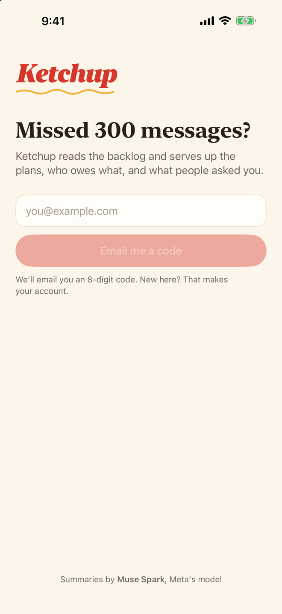
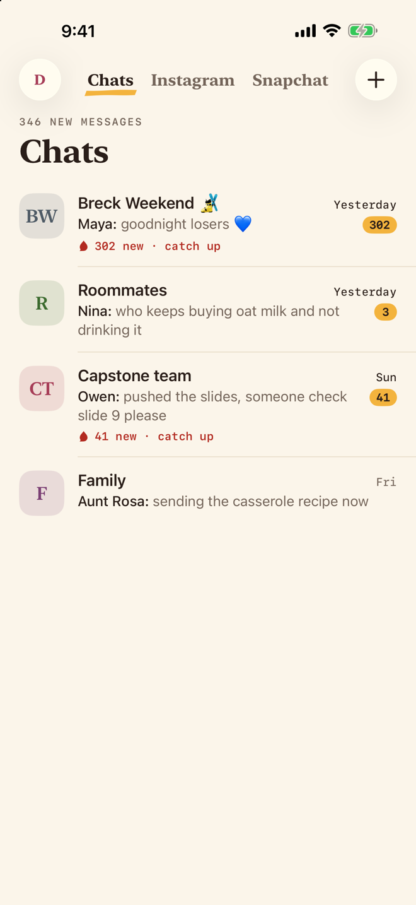
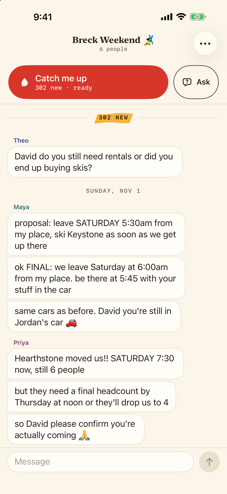
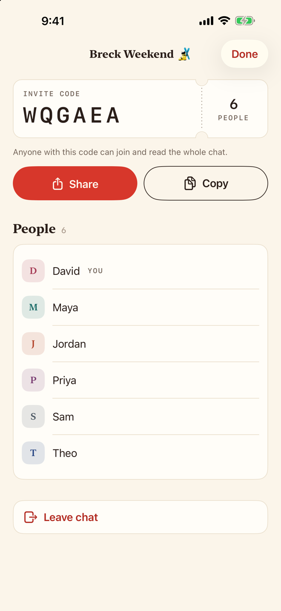

# Chat screens, redesigned

The chat side of Cetchup on the diner-counter design system (`docs/DESIGN.md`): sign-in, the name step, the home's tabs (Chats, Instagram, Snapchat and You), the inbox and its sheets, the chat thread, the chat info sheet and the app icon. Taken on an iPhone 17 Pro Max simulator from the offline previews, November 3, 2026. Every file has a `-light` and a `-dark` version unless noted.

<p>




</p>

| File | What it shows |
|---|---|
| `signin` | Wordmark, "Missed 300 messages?", paper email field, "Email me a code" |
| `signin-code` | The code step: 8 mono boxes in two halves, the resend countdown, the keyboard up |
| `name` | "What do your friends call you?" with a monogram that follows the name |
| `inbox` | The home's Chats tab: serif title, monogram rows, mustard badges, the "302 new · catch up" nudge from 15 unread, and the tab bar (a mustard mark under the tab you're on, the unread count on Chats) |
| `inbox-empty` | "Nothing on the counter yet" |
| `home-instagram` | The Instagram tab: `WebChatTab` (its slim bar, the site, the ketchup Catch me up circle on the right) on the synthetic test thread, over the tab bar |
| `home-snapchat` | The Snapchat tab the first time it opens: the intro card (sign in on Snapchat's own page, tap the ketchup drop and pick the last 30, 80 or 120, the catch-up kept on this phone only, the computer version shrunk to fit) and Got it, over the tab bar |
| `new-chat`, `join` | The "+" menu's sheets; Join has 6 code boxes |
| `chat` | The top of Breck: the ketchup "Catch me up" (prefetch landed, so "ready"), the "302 NEW" mark |
| `chat-middle` | Scrolled into the thread: runs from one sender, names in their person colors |
| `chat-jump` | A ref-chip jump mid-hold: the mustard marker behind Maya's "$90 each" |
| `info` | The invite code on a ticket, Share and Copy, members, Leave chat |
| `inbox-xxl-light`, `home-instagram-xxl-light`, `chat-xxl-light` | Extra Extra Large text (light only); the tab bar grows to this size and no further, like a system bar |
| `icon`, `icon-home` | The app icon at 240, 60, 40 and 29 pt, and on the home screen (light only) |

The old look is in `../foundation/` under the same names (`signin`, `inbox`, `inbox-empty`, `name`, `chat`, `info`).

To retake one, launch a DEBUG build with its name (`chat-middle` is `chat` scrolled by hand; add `-webchat.instagram.introSeen YES` to `home-instagram` to skip its first-visit card):

```bash
xcrun simctl launch --terminate-running-process <udid> com.vibetemp.ketchup -screen chat-jump
```
