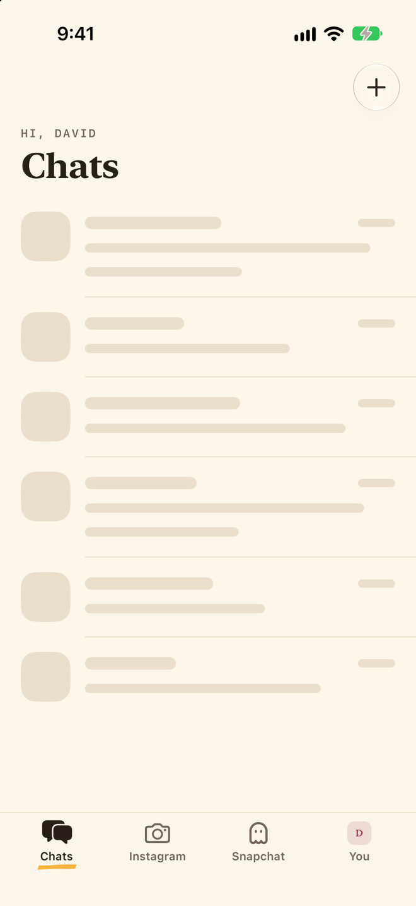
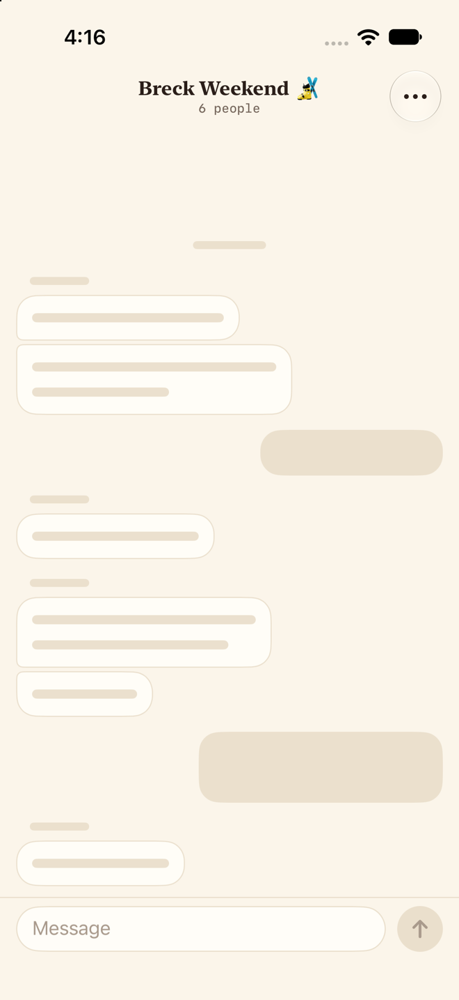
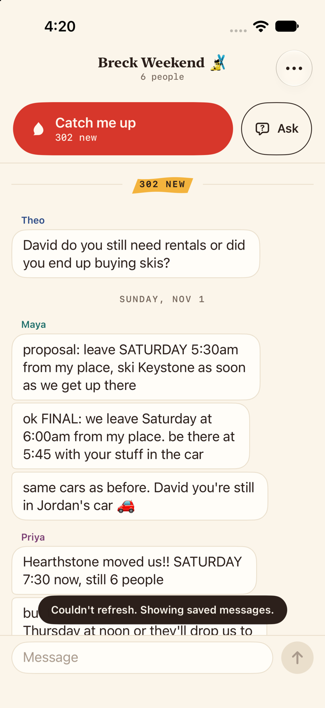
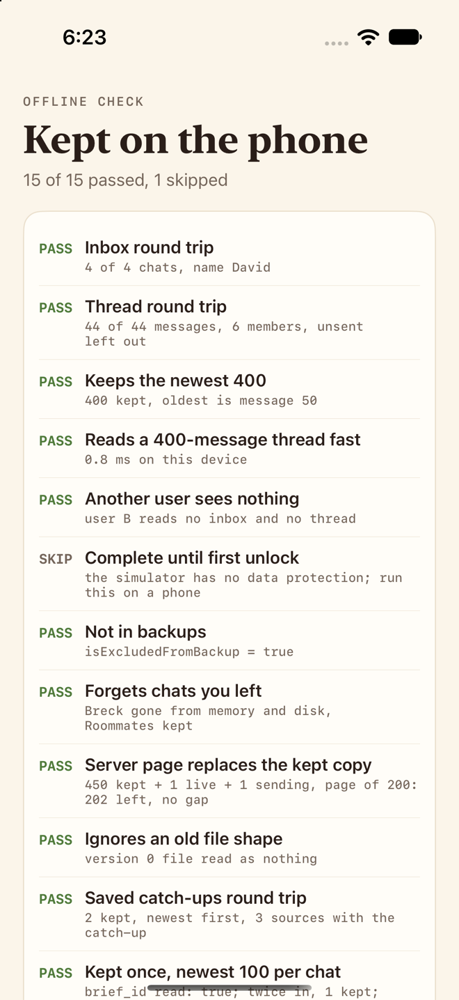

# First loads, the copy kept on the phone, and saved catch-ups

Skeletons, a chat opened on its kept copy with no server, saved catch-ups, Settings' two rows, and the offline store check. Taken on an iPhone 17 Pro simulator from the offline previews, November 3, 2026, at 660 px wide. Every file has a `-light` and a `-dark` version.

| File | What it shows |
|---|---|
| `inbox-loading` | The first launch's inbox: six rows of hairline paper in `ChatListRow`'s shape, under the real header |
| `chat-loading` | A chat's first open: a day line and bubbles in `ChatBubble`'s paper, at the bottom where a thread opens |
| `ai-loading-blank` | Catch me up opened before the thread's messages are here: the skim window, blank |
| `chat-kept` | Breck opened on the copy kept on the phone, with no server: placed on "302 new", Catch me up ready, and "Couldn't refresh. Showing saved messages." |
| `saved` | Breck's Earlier catch-ups: two answers and a catch-up, newest first, each with its time and message count, and Clear all |
| `saved-brief` | The saved catch-up opened: "‹ Earlier catch-ups", the brief, "Saved Nov 2 at 9:40 PM" in the byline |
| `saved-empty` | Nothing saved yet |
| `saved-quote` | A source shown as it was kept |
| `saved-all` | Every chat's saved catch-ups (Breck and the Instagram test thread) in its Settings bar, with Delete all |
| `settings-phone` | Settings' "On this iPhone": Saved catch-ups and Clear cache (a preview has nothing cached) |
| `store-check` | `-screen store-check`: 15 of 15 passed, 1 skipped (data protection needs a phone) |
